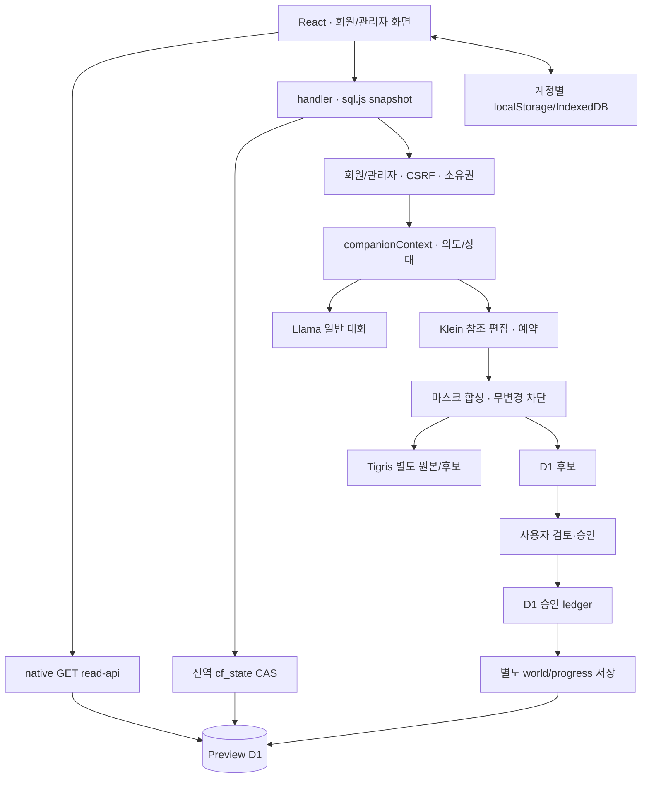

# BEYOND — 1~5단계 통합 안전성·안정성 검사

**READ-ONLY AUDIT / 한국어 보고서 / 2026-10-31 Asia/Rangoon(MMT, UTC+06:30)**
실환경 기준: **15:00–15:05 MMT(08:30–08:35 UTC)**. 이전 보고서의 실증과 이번 조회·정적 실행을 분리한다.

## 1. Executive Summary

**결론: 10명 파일럿도 무조건 진행 가능 판정은 보류한다.** 현재 보관 데이터의 무결성·권한 검사 구조는 확인되지만, P1 저장 경합·복구·브라우저 계정 격리 위험과 $0 과금 미확인 사항이 남는다. 사용자 수를30명에서10명으로 줄여도 요청 한 건의 CPU/메모리 한도와 강제종료 복구 문제는 해결되지 않는다.

- 기존72개 요청 해시 동일, 보고 세계 원본 Starter 메타데이터 동일, revision1–49 보존.
- D1 `foreign_key_check` 결과0건, `quick_check=ok`. 이는 업무 의미·모든 이미지·모든 권한 테스트 통과와 다르다.
- 현재 Preview 배포·바인딩·20,000행 snapshot/전역 CAS가 그대로 존재한다.
- 10명×30회=300회/일은 계획 가정이다. 사용자별30회 대화 제한을 추가하거나 제안하지 않는다.
- 이번 검사에서 AI 호출·예약·가입·로그인·승인·저장·부하 테스트·배포를 실행하지 않았다. **신규 보고서 이외 파일을 변경하지 않았다.**

분류: **CONFIRMED**는 실제 조회·기존 로그 또는 명시된 코드 구조 확인, **LIKELY**는 미재현 위험 추론, **UNVERIFIED**는 권한/증거/실행 제한으로 미확인. 정적 코드 존재를 기능 성공으로 판정하지 않는다. P0 사고가 발견되지 않았다는 사실은 P0가 없다는 증명이 아니다.

## 2. 현재 시스템 구조

진입점: `src/Root.tsx`, `cloudflare/worker.mjs`, `handler.mjs`, `read-api.mjs`; 기존 server API와 `cloudflare/generated/` 어댑터도 병존한다. 회원세계 JSON 안에 graph·Starter 참조가 있고 discoveries/progress/position sidecar가 대화·좌표·작업을 보관한다. 편집 객체 정보/승인은 `workers_ai_requests.response`에도 존재해 세계 JSON과 단일 테이블이 아니다.

현재 바인딩: ASSETS, Preview DB, Workers AI, APP_ORIGIN/BEYOND_STAGE, Tigris endpoint/bucket, AI 예산 vars, 관리자 allowlist 및 Tigris 비밀 바인딩(존재만 확인). 메일 제공자 비밀 바인딩 없음. DO 바인딩 없음. 이전 읽기 전용 Production 조회는 Supabase+ASSETS였으므로 Preview와 동등성을 가정하지 않는다. 이번 단계에서 Production 서비스 실행/설정 변경 없음.

## 3. 검사 환경과 안전 범위

|기준|이번 확인|
|---|---|
|Git|main, HEAD `f4585907ecb8158eafd61cc769c4c31e94d102c0`|
|작업 트리|시작 porcelain 출력: modified35, untracked100개 항목. untracked 디렉터리는 여러 파일을 묶으므로 실제 파일100개라는 의미 아님. staged 표시 없음.|
|파일 기준선|git가 열거한 기존295개 파일 SHA-256을 메모리에 기록. 새 보고서는 기준선 밖. 비밀 파일·값·세션을 보고서에 수록하지 않음.|
|배포|Preview `fa9bf8d2-3e39-41f5-8d27-9b69dff9c843`100%|
|D1|`beyond-migration-preview`, UUID `5b21c5ee-c783-40a4-b5ec-6e086b1aa6ed`,31테이블·1,499,136bytes·APAC, read replication disabled|
|Tigris|Preview100객체,208,407,792bytes, 목록 truncated=false. 다른 bucket/soft-delete/월 과금 포함량은 별도.|
|보안|회원/관리자 별도 세션·owner 검사. 비밀번호 hash/token 값은 읽어 출력하지 않음. schema의 열 이름은 값이 아님.|
|AI|일반 Llama `@cf/meta/llama-3.1-8b-instruct-fp8-fast`, 편집 Klein `@cf/black-forest-labs/flux-2-klein-4b`, 별도 일반 이미지 경로 FLUX.1 Schnell. 모델 호출0회.|
|비파괴 실행|제어 API GET, D1 SELECT/읽기 PRAGMA table function, Tigris LIST, 해시 대조, 부작용 없는 의도 함수10입력 관찰만 수행.|

D1 REST SELECT의 transport는 POST지만 SQL 쓰기가 아니다. 배포/마이그레이션/데이터 쓰기 기능이 있는 기존 `.local` 도구·npm 테스트·브라우저 도구는 실행하지 않았다. 테스트가 fixture DB·브라우저·아티팩트를 만들 수 있기 때문이다. 과거 감사의 타입/구문검사 통과를 이번에 재실행했다고 보고하지 않는다.

라이브 환경은 원자적 감사 스냅샷이 아니다. 직전 감사 대비 ledger81→91, 객체99→100, 실제 Neurons가 증가했다. 이번에는 모델/서비스 쓰기를 하지 않았으며 **증가 원인·행위자는 미확인**이다. 이후 수치를 첫 기준과 섞어 하나의 동시점 증거라고 주장하지 않는다.

## 4. 1단계 결과 — 저장·동시성·무결성

### D1 전체 구조·관계

실제 sqlite_master에서31개 테이블 확인:

- 시스템: `_cf_KV`, `sqlite_sequence`, `schema_versions`, `cf_state`, `cf_commit_guards`.
- editorial: `admins`, `worlds`, `discoveries`, `connections`, `revisions`, `settings`, `sessions`, `login_limits`, `legacy_sessions`, `legacy_login_limits`, `permanent_deletion_jobs`.
- 중앙/이미지: `central_characters`, `central_activity`, `managed_images`, `ai_generations`, `ai_character_assets`, `ai_asset_objects`, `workers_ai_requests`.
- 회원: `user_accounts`, `user_sessions`, `user_tokens`, `user_limits`, `user_world_assets`, `user_worlds`, `user_world_revisions`, `member_profiles`, `member_audit`, `member_deletions`.

관계는 실제 DDL과 일치: discoveries→worlds, connections→discoveries, sessions/revisions/central/managed creator→admins, member_profiles/sessions/tokens/assets/worlds→user_accounts, user_world_revisions(owner_id,world_id)→user_worlds 복합키, ai_asset_objects→ai_character_assets. ledger.actor/JSON objectId·asset 참조와 일부 삭제 journal은 FK로 모두 강제되지 않고 코드/JSON 무결성에 의존한다.

`SELECT * FROM pragma_foreign_key_check`=빈 결과, `SELECT * FROM pragma_quick_check`=`ok`. 동적 FK 목록 join은400으로 거부되어 전체 관계는 DDL 정적으로 보완했다. FK 통과로 JSON sidecar·객체 좌표·D1/Tigris 업무 원자성까지 통과한 것은 아니다.

### 저장 경합·원본 보존

`d1-store.mjs:10–20`은 selectedTables의 모든 행을 복사하며20,000행 검사도 결과 수신 뒤 수행한다. `flush():34`는 모든 호환 쓰기에 전역 revision guard를 사용한다. 새 native GET는 이 복사를 피하지만 AI/여러 관리자·인증·업로드 쓰기 경로에는 남는다.

한 회원 A가 reserve flush 후 모델을 기다리는 동안 B가 별도 세계를 저장하면 A 최종 flush의 전역 revision이 달라409가 가능하다. 성공한 모델을 재호출하지 않더라도 생성 후보를 못 남길 수 있다(IA01). 이번에는 동시성 실험을 하지 않았으므로 **발생 경로 분석이지 새로운 장애 재현은 아니다**.

`world-edits.mjs:100–104`는 랜덤 작업 prefix에 original/candidate를 If-None-Match로 보관한다. 기존 Starter·승인 parent를 정상 경로에서 덮지 않는다. 실패 catch는 fresh 파일만 정리하지만 Worker 강제종료는 catch를 거치지 않으므로 orphan/불완전 metadata가 가능하다. 원본/후보·D1 commit은 분산 원자 트랜잭션이 아니다. 관련 발견 IA01/02/03/05/09.

## 5. 2단계 결과 — AI·중복·승인·복구

서버 ledger 상태는 pending/success/error, UI 상태는 QUEUED/RUNNING/AWAITING_APPROVAL/APPROVED/SAVED/FAILED/CANCELLED 등으로 더 세분화되어 있다. 양자가 같은 단일 내구 상태 머신은 아니다.

- 예약은 provider 전에 flush하고 같은 ID/actor/hash 충돌을 검사한다. 그러나 parent 검증·원본 다운로드/decode·mask 작업이 기존 ledger 조회보다 먼저라 완전한 저비용 replay는 아님.
- pending TTL/lease·provider 완료 확인·수동 증거 기반 복구 규약이 없다. 브라우저 Abort는 제공자 취소를 뜻하지 않는다. 현재 전체 pending5개(오늘3/이전2), 오늘 내부 이미지 예약984.6315.
- 불명 실패를 성공으로 세거나 무조건 환불하지 않는 보수적 처리는 안전하다. 반면 다음 날에도 같은 operation 문맥이 RUNNING에 남을 가능성은 별도 문제다. pending 하나가 모든 다른 편집을 항상 차단하는 것은 아니다.
- 승인 API는 ledger를 갱신하고 프런트가 별도로 progress를 저장한다. 승인 후 progress 저장 실패는 retry 안내가 있지만 두 작업의 원자성은 없다.
- 기본 활성 이미지는 approved 중 최신 버전에서 선택하고 미승인 candidate는 review로 분리한다. 자동 approve 정상 경로는 확인하지 못했다. API200/후보 승인/시각 품질은 각각 별개다.
- 무변경 guard·전체 보호 영역 차단 코드가 존재한다. 수정 후 별장의 새 실제 모델 성공은 미검증이며 과거0픽셀 별장 기록은 삭제되지 않았다.

현재 실제 호출·후보 생성·승인·거절은0회. 기존 실제 모델 증거만 참고했으며 관련 발견 IA01/04/05/07/08/09/15.

## 6. 3단계 결과 — 보안·권한·비동기

`user-auth.mjs:6–13`은 member status=active, 만료·credential_version·user token을 검사하고 회원 world/asset API가 owner 조건을 적용한다. 관리자 allowlist+sole-admin+별도 세션/CSRF도 유지된다. 정지·삭제대기 계정은 세션 폐기 및 status guard로 차단하도록 설계되었다. 실계정 A/B 공격 시도는 하지 않았다.

회원 cookie: `__Host-`, HttpOnly, Secure(HTTPS), SameSite=Lax,30일. 관리자 cookie: HttpOnly/Secure/Strict, 기본8시간. 비밀번호 scrypt N32768/r8/p1·salt·64byte key와 timing-safe 비교. 약화 제안 없음.

Rate limit 정적 확인: 회원 login IP20/시간·email8/시간, signup/forgot 등 IP10/시간·email4/시간, reset은 IP 제한과 유효1회 token·credential version 검증. 관리자 login IP20/15분·계정6/15분. 제한 저장도 전역 CAS/CPU 실패 영향을 받을 수 있으므로 실효성 전체를 실측 통과했다고 말하지 않는다.

DTO는 password_hash/session cookie 원문을 응답에 넣지 않는다. `csrf`와 세션 만료 시각을 인증된 클라이언트에 제공하는 것은 의도된 프로토콜이며 로그인 cookie/token 노출과 구분한다. 이 보고서는 그 값들을 기록하지 않는다.

`cloudWorlds.ts:23–25` hydrate는 await 후 변경된 currentUserId에 캐시를 쓸 수 있다. refreshWorlds의 loop 진입 guard와 persistWorld의 일부 guard만으로 모든 await 경계가 보호되지는 않는다. IndexedDB도 operation 시작 때 현재 사용자 DB를 열므로 중간 전환 분석이 필요하다. **서버 타 계정 권한 우회가 확인된 것은 아니지만 브라우저 격리 위험 LIKELY**(IA06).

## 7. 4단계 결과 — 성능·무료 한도·비용

현재 Workers 구독 조회는 다시403. 따라서 **실제 계약 플랜 UNVERIFIED**이며 과거 Free 선택/100328 거절 기록과 Free 가정의 한도를 근거로 분석한다.

|항목|공식 한도·설정|실제 조회·미확인|
|---|---|---|
|Workers Free 가정|10ms CPU·128MB isolate·100k요청/일·subrequest50·outbound동시6|일일 Preview 결과: success824/exceededResources55/clientDisconnected1. 계정 총량·메모리 peak·현재 billing 미확인.|
|D1 Free 가정|read5M행/일·write100k행/일·DB500MB/계정5GB·쿼리50/호출|DB약1.50MB. 일일 rows read/write·다른 DB 합계 미확인.|
|Workers AI|실제 무료10,000 Neurons/일; 내부service9000/text8000/image1000, 계정image3|15:05 MMT 계정24회·1017.27904896 Neurons. 내부text41/image984.63148682. 서로 다른 기간/범위/계측 방식이다.|
|Tigris|Standard월5GB·ClassA10k·ClassB100k 포함, egress무료|Preview100개/208,407,792bytes. 전체 계정 용량·월 요청량·과금/card/차단 정책 UNVERIFIED.|
|Cron/DO|기존cron03:30UTC=10:00MMT 한 개; Preview DO없음|설정 변경 없음. 삭제 cron의 실행당 작업량 위험은 남음.|

문서 근거: [Workers Limits](https://developers.cloudflare.com/workers/platform/limits/)(2026-10-29), [1102](https://developers.cloudflare.com/support/troubleshooting/http-status-codes/cloudflare-1xxx-errors/error-1102/)(2026-04-23), [D1 Limits](https://developers.cloudflare.com/d1/platform/limits/)(2026-10-30), [D1 Pricing](https://developers.cloudflare.com/d1/platform/pricing/), [AI Pricing](https://developers.cloudflare.com/workers-ai/platform/pricing/)(2026-10-20), [Tigris Pricing](https://www.tigrisdata.com/pricing/). 공식 자료는 직전 당일 감사 조회를 재사용하며 새로 재조회했다고 주장하지 않는다.

### 10명·300회/일·9000회/월 시나리오

- 평균 text 비용10/20/30 Neurons라면 하루3000/6000/9000. 마지막은 내부8000을 초과한다. 이는 가정 범위이지 실제 평균이 아니다. 월9000개와 provider의 **일일**10,000을 직접 비교하지 않는다.
- text8000/300≈26.67 Neurons/메시지. `textReservation()`은 UTF-8 system/history bytes+최대출력으로 계산한다. 384출력 항만 약13.39, 입력4000bytes 가정이면 총 예약약32. usage settlement 뒤 실제 평균은 달라질 수 있으므로 시스템 프롬프트/12개 이력·30개 기억이 포함된 분포가 필요하다.
- Klein 현재 quote109.4035이면 image1000으로 전역 약9개/일.10명×개인3=30건을 보장하지 않으며30건 추정3282.1은 내부 이미지 예산 초과다. 대화 개인30회 제한으로 바꾸는 해결책은 제안하지 않는다.
- 현재 이미지 잔여15.3685 < 다음109.4035. 모델 재실행/별장 재검증을 해서는 안 되는 내부 상태다. 일반 대화41/8000은 별개로 남아 있다.
- 일반 대화300건이 매일 ledger에 남는다면20,000행까지 약66일 규모, revision도 매번 남아 broad admin snapshot이 함께 읽는다면 약33일 규모라는 조건부 분석. 도구형 메시지 비율·실제 저장 수에 따라 달라지며 현재 초과는 아니다.
- 호환 snapshot 쿼리 수뿐 아니라 매번 읽는 행·JSON 크기가 증가한다. 현재 전체 rows를 근거 없이 일일 D1 사용량으로 환산하지 않았다. 총 read/write 실측 권한·데이터가 없어 정량 보장은 불가하다.
- 현재 약4.8MB PNG 사례에서 편집당 원본+후보 약9.6MB, 하루9건×30일이면 약2.59GB/월 추가 시나리오. 보관 기간·복제·다른 bucket·원본·미승인 기록이 추가된다. 사용자10명이라도 같은 전역 이미지9건이면 이 수치는 동일하다.

### 오류·자원 분리

스타일 `a52fd852de01d5f9`(10:46:38MMT/04:16:38UTC)는 HTML1102이며 CPU/메모리 구분 미확인. 업로드(10:50:39/04:20:39)는 실제 tail의 exceededCpu/CPU681ms/wall927ms. 공개 캐릭터 `a52fe2f9fec8262f`(10:53:50/04:23:50)는1102. 과거51개와 현재55개 exceededResources를 같은 개별 요청 원인으로 묶지 않는다.

네트워크 대기는 wall에 포함되지만 CPU에 포함되지 않는다.2048² original/full/mask/weights 약64MiB와 PNG scan 약16MiB+WASM/SQL/동시 요청은 메모리 위험 추론이며 실측 peak가 아니다.1102는 JS catch로 항상 복구/JSON화할 수 없다.

## 8. 5단계 결과 — 사용자 기능·언어·관리자

|검사항목|정적 확인·한계|
|---|---|
|가입/로그인|email+unique username+password, verified_at 없이 즉시 member session. `/explore` 또는 보존된 creation-intent 경로로 이동.30일 cookie와 초기 session reload로 refresh/restart 복원하도록 설계. 실제 로그인은 이번에 안 함.|
|메일 복구|Preview RESEND_API_KEY/AUTH_EMAIL_FROM 없음. forgot는503으로 정직하게 표시. 이메일 인증 없이 가입된다는 정책과 암호 분실 복구 미완료를 구분.|
|세계 생성·수정|owner+CSRF+version/idempotency·asset hash 검사. user-world 데이터와 user-worlds prefix에 별도 사본 저장. admin managed Starter 원본을 편집할 정상 경로는 아님.|
|세계 삭제|회원 `/api/user/worlds/:id`는 GET/POST/PUT이고 DELETE는405. 개별 서버 세계 삭제는 확인되지 않음. 관리자 editorial 영구삭제·전체 계정30일 삭제와 다름. 기능 공백으로 IA16에 기록.|
|여러 기기|서버 D1/자산 hash 기반 복원, stale write409·pending draft 있음. 실기기 동시 수정·scope 경합 미검증.|
|일반 인사|순수 의도 함수에서 한/영/서/일/중 인사5개 모두 GENERAL_CHAT. 실제 모델 답변·자연스러움 검증 아님.|
|명확한 생성|한글 집/별장 요청2개 CREATE_WORLD_OBJECT. 일본어 집 생성·중국어 집 생성2개는 GENERAL_CHAT으로 관찰되어 다국어 실제 실행 분류 공백 확인.|
|동의/기억|pending 없는 ‘그렇게 하자’는 GENERAL_CHAT. pending 기반 후속 동의는 코드 경로만 검토. 최근 visitor30개·최근대화12개 사용, 영속 장기 요약 메모리 없음.198개 이력 제한.|
|언어|UI en/es만 활성, ko/ja/zh 계열은 coming soon. 모델에 입력 언어 응답 지시가 있다는 사실로5언어 UI/의도/실행 완료를 판정하지 않음.|
|관리자11메뉴|Dashboard/Worlds/Characters/Connections/Analytics/Settings/Users/Content/Discoveries/Activity Log/Image Management 존재. 별도 관리자 route·server guards. 일반 회원에 관리자 권한이 부여되는 정상 경로 없음. route 이름 노출과 권한 부여는 다름.|
|정지/복구/삭제|status 변경 시 session/token 폐기·credential version 증가.30일 내 암호 기반 owner recovery, cleanup 시작 후 복구 불가. cron은 limit5계정이나 계정당 파일 수는 무제한 loop. 공유 Starter/central prefix는 계정 cleanup 대상 밖. 실제 실행 안전성 전체는 미검증.|
|로딩/모바일|초기 Universe 실패는 전체 진입을 막음. background 실패는 기존 data 유지. hydrate 한 asset 실패는 account refresh 완료를 막을 수 있음. viewport/keyboard/media query는 정적 검토만.|
|오류/성공 약속|quota/CPU/resource/network/timeout/position conflict/보호영역/no-change 구분 코드 있음. 반환 상태와 UI state가 달라질 수 있는 창은 남음. 인사·작업완료 약속의 실제 모델 품질은 이번 미검증.|

## 9. P0~P3 전체 발견 사항

P0로 확정된 유출/손실/권한 우회는 발견하지 못했다. 아래 재현은 **다음 승인된 격리 환경에서 실행할 시나리오**이며 이번에 실제 실행한 장애/부하 테스트가 아니다. CONFIRMED가 정적 구조인 경우 명시한다.

### IA01 — P1

- **발견 ID:** IA01
- **심각도:** P1
- **실제 확인 여부:** CONFIRMED(전역 CAS 구조), LIKELY(동시 실패)
- **관련 파일·함수/API:** cloudflare/d1-store.mjs:34 flush; world-edits.mjs:83,103; handler；API: `/api/user/worlds/:id · /api/ai/world-edits`
- **구체적인 원인:** 작업별이 아닌 cf_state revision을 모든 호환 쓰기가 공유한다.
- **재현 가능한 시나리오(미실행):** A reserve 후 모델 대기 중 B가 다른 세계 저장→A 후보 최종 flush.
- **사용자 영향:** 후보가 생성돼도409/저장 실패, 재시도 혼란.
- **기존 데이터 영향:** fresh 후보 정리/추론 비용 잔존 가능. 기존 승인 원본을 지운 증거는 없음.
- **권장 해결 방법:** 세계·작업 단위 CAS와 내구 결과 receipt를 설계.
- **수정 시 주의:** 세션 guard/무료 예약/기존 history를 약화하거나 모델을 자동 재호출하지 말 것.
- **수정 후 필수 검증:** 두 사용자·두 세계·모델 대기 중 제3자 쓰기·후보/원본/예약 대조.
### IA02 — P1

- **발견 ID:** IA02
- **심각도:** P1
- **실제 확인 여부:** CONFIRMED(코드), LIKELY(성장 한도 장애)
- **관련 파일·함수/API:** cloudflare/d1-store.mjs:10–20 openD1Store; handler selectedTables；API: `AI/회원 인증·저장·admin 호환 API`
- **구체적인 원인:** 전체 selected table 복사 후20,000행 검사; byte budget·일반 ledger/history 보존 상한 없음.
- **재현 가능한 시나리오(미실행):** ledger/revision을 늘린 격리 fixture에서 호환 AI/admin 호출.
- **사용자 영향:** 누적 시간이 지나면 CPU/메모리·행 상한으로 서비스 실패.
- **기존 데이터 영향:** 데이터가 있어도 읽기/쓰기 불가; 임의 정리 시 손실 위험.
- **권장 해결 방법:** scoped SQL·페이지/byte 한도·보존 구조 개선.
- **수정 시 주의:** 20,000을 무작정 올리거나 과거 기록 삭제로 우회하지 말 것.
- **수정 후 필수 검증:** 경계19,999/20,000/20,001·큰 JSON·메모리/쿼리 수 검사.
### IA03 — P1

- **발견 ID:** IA03
- **심각도:** P1
- **실제 확인 여부:** CONFIRMED(과거 CPU 로그), LIKELY(메모리 압력)
- **관련 파일·함수/API:** world-edits.mjs:78–103; user-worlds.mjs assets; runtime-images; server/auth scrypt；API: `/api/user/assets · /api/ai/world-edits · /api/user/auth/login`
- **구체적인 원인:** 이미지 다중 full buffer·WASM/SQL·hashing이 Free 한 건 자원 한도와 충돌.
- **재현 가능한 시나리오(미실행):** 최대 크기·동시성은 실제 서비스 아닌 승인된 격리 프로파일로 확인.
- **사용자 영향:** 1102/503·업로드/생성 중단.
- **기존 데이터 영향:** 원본은 보관되나 pending/orphan·후보 유실 가능.
- **권장 해결 방법:** lossless 연산/수명/크기·작업분할과 운영 상한 검토.
- **수정 시 주의:** 암호 해싱 약화·품질 손실·원본 덮기·요금제 변경 금지.
- **수정 후 필수 검증:** CPU/wall/peak memory 분리, source/후보 hash·바깥 픽셀 검사.
### IA04 — P1

- **발견 ID:** IA04
- **심각도:** P1
- **실제 확인 여부:** CONFIRMED(복구 부재·pending 존재)
- **관련 파일·함수/API:** workers-ai.mjs reserve/releaseUnstarted; companion-context.mjs:32–38；API: `/api/ai/world-edits · /api/ai/text`
- **구체적인 원인:** pending TTL/lease/provider 완료 확인·내구 재개 protocol 없음.
- **재현 가능한 시나리오(미실행):** reserve 뒤 Worker 강제종료/브라우저 종료 상태를 fixture로 주입.
- **사용자 영향:** 같은 작업이 영구 RUNNING, 취소/당일 이미지 입장 제한.
- **기존 데이터 영향:** 미완료 작업·예약은 남음; 임의 환불은 실제 무료 초과 위험.
- **권장 해결 방법:** 증거 기반 reconciliation 및 동일ID 결과 조회.
- **수정 시 주의:** 응답 없음=provider 미실행/취소라고 단정하지 말 것.
- **수정 후 필수 검증:** 호출 전/후 종료·완료 후 DB 실패·다음 날 같은ID·취소 구분.
### IA05 — P1

- **발견 ID:** IA05
- **심각도:** P1
- **실제 확인 여부:** CONFIRMED(별도 commit 구조)
- **관련 파일·함수/API:** world-edits.mjs approve; WorldCompanion.tsx:50 decide；API: `/api/ai/world-edits/:id/approve · /api/user/worlds/:id`
- **구체적인 원인:** 승인 ledger와 world/progress는 별도 트랜잭션.
- **재현 가능한 시나리오(미실행):** approve 성공 직후 sidecar 저장 실패/브라우저 종료.
- **사용자 영향:** 이미지는 승인됐지만 UI/작업 상태가 stale할 수 있음.
- **기존 데이터 영향:** 원본 손상보다 승인·대화·revision 연결 불일치 위험.
- **권장 해결 방법:** 승인 receipt와 세계 version 연결·재접속 reconciliation.
- **수정 시 주의:** 기존 승인·revision·미승인 후보 경계를 유지.
- **수정 후 필수 검증:** 승인 중복·부분 성공·refresh/다른 기기 복원·원본 보존.
### IA06 — P1

- **발견 ID:** IA06
- **심각도:** P1
- **실제 확인 여부:** LIKELY(비동기 계정 격리 위험, 미재현)
- **관련 파일·함수/API:** cloudWorlds.ts:23–25 hydrate/fetchWorld; AccountProvider.tsx:8；API: `/api/user/worlds · /api/user/worlds/:id · /api/user/assets/:id`
- **구체적인 원인:** await 완료 후 변경된 currentUserId로 로컬 캐시/sidecar/asset을 쓸 수 있음.
- **재현 가능한 시나리오(미실행):** A hydrate를 지연시킨 뒤 logout/B 전환 후 A 응답 완료.
- **사용자 영향:** 잘못된 브라우저 계정 scope에 A 자료가 보일 가능성.
- **기존 데이터 영향:** 서버 owner 우회는 확인되지 않았지만 로컬 개인정보/초안 오염 위험.
- **권장 해결 방법:** account generation 캡처·await 경계 검증·취소·commit guard.
- **수정 시 주의:** 계정별 IndexedDB와 legacy 자료를 지우거나 공용 scope로 합치지 말 것.
- **수정 후 필수 검증:** 자산 fetch/IDB/write 단계별 전환·만료·다중 탭·세션 교체.
### IA07 — P1

- **발견 ID:** IA07
- **심각도:** P1
- **실제 확인 여부:** CONFIRMED(정적 쿼리 순서)
- **관련 파일·함수/API:** companion-context.mjs:8,33 companionContext；API: `/api/ai/text(kind=companion) · GET /api/ai/world-edits`
- **구체적인 원인:** actor LIMIT100 뒤 world 필터; native GET와 순서가 다름.
- **재현 가능한 시나리오(미실행):** 다른 세계 편집100개 뒤 오래된 세계의 집/후보 조회.
- **사용자 영향:** 존재하는 집을 찾지 못하거나 후보 중복 방지가 달라질 수 있음.
- **기존 데이터 영향:** 원본 삭제는 아니나 대상·작업 연결 손상 가능.
- **권장 해결 방법:** world 조건을 SQL에 먼저 적용하고 객체/버전 계약 통일.
- **수정 시 주의:** 기존 objectId fallback·승인·pending 기록 보존.
- **수정 후 필수 검증:** 100개 경계·여러 세계·오래된 후보·대상 ID/좌표 확인.
### IA08 — P1

- **발견 ID:** IA08
- **심각도:** P1
- **실제 확인 여부:** CONFIRMED(멱등 조회가 늦음)
- **관련 파일·함수/API:** world-edits.mjs:64–83; WorldImageEditor.tsx；API: `POST /api/ai/world-edits`
- **구체적인 원인:** parent/원본 decode/보호 검사 뒤 ledger existing 조회.
- **재현 가능한 시나리오(미실행):** 같은 요청을 성공/승인 이후 동일 입력으로 replay.
- **사용자 영향:** cached 결과 대신409나 불필요 CPU/파일 읽기 가능.
- **기존 데이터 영향:** 모델 중복 방어는 존재하지만 결과 복구 실패/추가 비용 위험.
- **권장 해결 방법:** 인증·소유권 후 안정 작업ID 결과 조회를 앞당김.
- **수정 시 주의:** 다른 actor/hash의 ID 재사용을 허용하지 말 것.
- **수정 후 필수 검증:** 동일ID pending/success/error·승인 전후·다른입력/다른계정 충돌.
### IA09 — P1

- **발견 ID:** IA09
- **심각도:** P1
- **실제 확인 여부:** CONFIRMED(경로 차이), LIKELY(보호 영향)
- **관련 파일·함수/API:** WorldImageEditor.tsx:31; world-edits.mjs:68,72；API: `POST /api/ai/world-edits`
- **구체적인 원인:** 레거시 UI는 actionType 생략; target/protectedObjects 적용이 companion과 다름.
- **재현 가능한 시나리오(미실행):** 동일 위치의 기존 집에 legacy 자유 편집과 companion 새 객체 요청 비교.
- **사용자 영향:** 기존 건물 영역이 바뀌는 의미적 보호 차이.
- **기존 데이터 영향:** 보관 원본과 마스크 밖은 별도 보호되나 승인 세계 내 객체 손상 가능.
- **권장 해결 방법:** 자유 편집/객체 편집 계약과 서버 필수 검증 통일.
- **수정 시 주의:** 기존 자유 편집 기능을 승인 없이 제거하지 말 것.
- **수정 후 필수 검증:** 두 UI 경로·target 없는 요청·보호 겹침·원본/후보 비교.
### IA10 — P1

- **발견 ID:** IA10
- **심각도:** P1
- **실제 확인 여부:** CONFIRMED(메일 미설정)
- **관련 파일·함수/API:** user-auth.mjs:17–24 emailReady/sendToken; Preview bindings；API: `/api/user/auth/forgot · /api/user/auth/reset`
- **구체적인 원인:** 실제 reset 메일 발송 제공자/발신자 없음.
- **재현 가능한 시나리오(미실행):** 실계정 요청 대신 정적 emailReady 분기·fixture transport로 검증 예정.
- **사용자 영향:** 암호 분실 시 실제 복구 미완료.
- **기존 데이터 영향:** 기존 password hash/세계는 유지되나 접근 회복이 어려움.
- **권장 해결 방법:** 승인된 발신자·비밀 설정과 실제 메일 검증 계획.
- **수정 시 주의:** 채팅 암호/검증 우회/강제 password 변경 금지.
- **수정 후 필수 검증:** 실발송·만료/1회사용·credential/session 폐기·누락 설정 메시지.
### IA11 — P1

- **발견 ID:** IA11
- **심각도:** P1
- **실제 확인 여부:** CONFIRMED(관측/권한 공백), UNVERIFIED(청구)
- **관련 파일·함수/API:** workers-ai.mjs budgetState/imageCost; Tigris adapter; subscriptions API；API: `AI API 전체 · Tigris S3 · account subscriptions GET`
- **구체적인 원인:** 내부 ledger와 계정 전체 provider 실사용이 별개. Tigris 청구/card·월 quota·현 Workers 플랜 확인 불가.
- **재현 가능한 시나리오(미실행):** 승인된 read-only 대시보드/계약 증거로 현재 지표 대조.
- **사용자 영향:** 계획보다 이른 제한 또는 확인하지 못한 서비스 과금 위험.
- **기존 데이터 영향:** 한도 거절은 데이터 보존 설계이나 $0 보장은 아님.
- **권장 해결 방법:** 계정 전체 headroom·월 계측·과금 차단/알림의 실제 계약 확인.
- **수정 시 주의:** 설정 상향·Paid 활성화·불명 예약 환불로 우회하지 말 것.
- **수정 후 필수 검증:** 하드 한도 전 입장 차단·다른 Worker 사용·지연 집계·Tigris 초과 정책.
### IA12 — P2

- **발견 ID:** IA12
- **심각도:** P2
- **실제 확인 여부:** CONFIRMED(순수 함수 관찰·UI 설정)
- **관련 파일·함수/API:** shared/companion-intent.mjs; companion-context.mjs:7,22; src/locales/index.ts；API: `/api/ai/text(kind=companion) · 언어 UI`
- **구체적인 원인:** 일/중 생성 문장이 GENERAL_CHAT, en/es UI만 활성, 기억은 최근30/12.
- **재현 가능한 시나리오(미실행):** 보고서8절10문장 정적 실행; 후속 동의/부정은 별도 격리 corpus.
- **사용자 영향:** 계획 설명만 하고 실제 편집 실행 안 함, 기억/언어 기대 차이.
- **기존 데이터 영향:** 오분류된 실행은 의미상 잘못된 후보·대화 기록 가능.
- **권장 해결 방법:** 언어별 의도/확인·대상 명시·기억 범위 UX 설계.
- **수정 시 주의:** 모델 자연어를 작업 성공 증거로 사용하지 말 것.
- **수정 후 필수 검증:** 5언어 인사·생성·편집·부정·인용·모호함·동의와 실제 상태 대조.
### IA13 — P1

- **발견 ID:** IA13
- **심각도:** P1
- **실제 확인 여부:** CONFIRMED(삭제 loop), LIKELY(배치 한도)
- **관련 파일·함수/API:** member-management.mjs:25–32 cleanDueMembers; worker scheduled；API: `scheduled cleanup · /api/admin/users/:id/* · /api/user/account/delete`
- **구체적인 원인:** limit5는 계정 수이며 계정당 전체 prefix 열거·파일마다 flush는 무제한.
- **재현 가능한 시나리오(미실행):** 다수 파일 계정·delete 중단·restore 경계를 격리 fixture에서 재현.
- **사용자 영향:** 30일 이후 cleanup 미완료/재시도 지연.
- **기존 데이터 영향:** 일부 파일 삭제 후 metadata/journal이 남는 단계가 가능. shared prefix는 대상 밖.
- **권장 해결 방법:** 실행당 파일/페이지·subrequest budget·checkpoint 검토.
- **수정 시 주의:** 실제 계정 purge/복구 기한 변경·중앙 원본 삭제 금지.
- **수정 후 필수 검증:** 기한/동시restore·중단 후 재개·prefix 안전·공유 Starter 보존.
### IA14 — P1

- **발견 ID:** IA14
- **심각도:** P1
- **실제 확인 여부:** CONFIRMED(의존 구조), LIKELY(확산)
- **관련 파일·함수/API:** UniverseProvider; AccountProvider.reload; cloudWorlds.hydrate; worker.mjs:10；API: `/api/public/universe · /api/user/auth/session · /api/user/worlds`
- **구체적인 원인:** 초기 public universe·전체 asset hydrate·공통 Tigris 초기화가 다른 흐름과 결합.
- **재현 가능한 시나리오(미실행):** 초기/background 실패, 단일 bad asset, media 설정 누락을 fixture에서 주입.
- **사용자 영향:** 전체 초기 진입 또는 account refresh가 막힐 수 있음.
- **기존 데이터 영향:** 현재 열린 세계/서버 데이터 보존과 초기 진입 실패는 구분 필요.
- **권장 해결 방법:** 선택 세계 우선·독립 오류/재시도·lazy storage 의존.
- **수정 시 주의:** 실패를 빈 세계 생성/로그아웃 성공/데이터 삭제로 바꾸지 말 것.
- **수정 후 필수 검증:** 초기/백그라운드/단일자산 실패·중복요청·모바일 복구.
### IA15 — P2

- **발견 ID:** IA15
- **심각도:** P2
- **실제 확인 여부:** CONFIRMED(과거 시각 결과), UNVERIFIED(완전 품질)
- **관련 파일·함수/API:** world-edits.mjs maskFor/protect/composite/prompt; companionScene；API: `/api/ai/world-edits · image/original GET`
- **구체적인 원인:** 타원+512crop은 footprint/교량 endpoint solver가 아님. 픽셀 변화는 의미 품질 증거 아님.
- **재현 가능한 시나리오(미실행):** 기존 집 style bbox/다리 양끝 접속·별장 별도 위치를 승인 후 최소모델로 검증 예정.
- **사용자 영향:** 건물 크기 변화·부자연스러운 연결·무의미한 결과.
- **기존 데이터 영향:** 마스크 밖0이라도 영역 안 기존 객체 의미가 달라질 수 있음.
- **권장 해결 방법:** 구조적 제약·비교/선택 UI·품질 합격 기준 정의.
- **수정 시 주의:** 원본/마스크/모델 기본값 유지, 추가 AI는 예산·승인 필요.
- **수정 후 필수 검증:** 같은ID·좌표·bbox/실루엣·기존집 보존·별장 분리·무변경 거절.
### IA16 — P2

- **발견 ID:** IA16
- **심각도:** P2
- **실제 확인 여부:** CONFIRMED(기능/계측 범위)
- **관련 파일·함수/API:** user-worlds.mjs:22; server/api admin overview; member-management DTO；API: `DELETE /api/user/worlds/:id · /api/admin/*overview · /api/admin/users`
- **구체적인 원인:** 회원 개별 세계 DELETE405; admin/editorial/member 통계와 provider 실제 지표는 서로 다름.
- **재현 가능한 시나리오(미실행):** 라우트/DTO 정적 검사, 실제 DELETE/관리자 수정 미실행.
- **사용자 영향:** 삭제 기능 기대 및 대시보드 운영 판단과 실제 범위 불일치.
- **기존 데이터 영향:** 잘못된 삭제 우회나 잘못된 quota 판단으로 이어질 수 있음.
- **권장 해결 방법:** 삭제 요구 범위·보존/복구 정책과 통계 scope 명확화.
- **수정 시 주의:** 계정 전체 삭제를 개별 세계 삭제 대체로 안내하지 말 것.
- **수정 후 필수 검증:** 권한/삭제정책·공유 콘텐츠·통계별 기간/대상/예약/실제 구분.

## 10. 데이터 보존 상태

현재 SELECT 기준 **기존72개 요청 JSON SHA-256 전부 동일**, 보고 세계version49·Starter 메타데이터 동일·revision1–49 모두 존재. 원본 Starter 기준 해시: `ef73fd5ab860357334433a991e68d1b1c61957f20f70d2bbc11220424d60882d`. 해시는 콘텐츠 무결성 식별자이며 인증 비밀이 아니다.

직전 감사에서 원본 Starter 실물 GET hash와 승인 style/bridge 원본·후보4객체 hash를 확인했다. 이번에는 그 모든 byte GET를 다시 실행했다고 주장하지 않는다. 당시 회원 asset15+성공edit12 참조 key 누락0, ACL private. 이번 LIST는100객체/208,407,792bytes이며99개였던 이전 목록과 다른 시점이다. 신규 객체를 orphan으로 단정하거나 삭제하지 않았다. 모든 파일 byte/모든 JSON 업무 관계의 무결성은 UNVERIFIED.

**감사 종료 대조: 기존295개 파일 SHA-256 변경0개, 삭제0개. 추가 파일은 `BEYOND_INTEGRATED_AUDIT_1-5.md` 한 개뿐임을 확인했다.** 보고서 외 코드를 쓰거나 formatter/build/test 아티팩트를 생성하지 않았다. 라이브 시스템의 동시 외부 변화까지 감사가 멈추거나 보장한 것은 아니다.

## 11. 10명 파일럿 운영 가능성

**상태: P1 조치·복구 검증을 선행하는 조건부 보류.** 현재9개 세계/작은 DB와 과거 실제 성공만으로10명 동시/장기 안정성을 보증할 수 없다.10명은 per-request CPU 한도를 늘리지 않는다.

우선 통과 조건: IA01/04/05 저장·복구, IA06 계정 scope, IA02/03 규모·자원 상한, IA07 오래된 대상·멱등 처리, IA13 cleanup 안전성. 일반 대화-only 소규모 관찰을 별도로 승인할 수는 있으나 본 감사는 그러한 실제 파일럿 실행 승인이 아니다.300회/일도 최악 입력/응답 분포를 정하지 않으면 보장량이 아니다.

## 12. 월 $0 운영 가능성과 미확인 과금

**확정 불가.** 현재 Neurons는 무료 일일10,000보다 작고 내부 보호가 있지만, 현 Workers 플랜 API403 및 Tigris 월 청구·hard-cap 미확인이 남는다. Free 한도 초과가 Workers/D1의 서비스 거절로 끝나는 조건과, Tigris 무료 포함량 이후 과금 조건은 다르다. 자동 결제/유료 전환이 현재 절대로 없다는 독립 증거는 확보하지 못했다.

계정300회/일 대화가 평균20 Neurons라면6000+전역이미지9건 약985는 가정상10,000 이내지만 실제 토큰·다른 Worker·지연 집계·실패 비용은 별도다. 평균30이면 내부 text8000 초과. 월 약9000대화에 필요한 누적 storage/row read/write, Tigris 월 요청을 함께 관측해야 한다. 사용자에게 개인30회 강제 제한을 새로 넣는 방식은 제안하지 않는다.

## 13. 수정 우선순위

- **P0:** 새로 확인된 사고 없음. 발견 시 복구·권한 격리를 우선하되 이번 감사에서 임의 조치하지 않는다.
- **P1 선행:** IA01/02/03/04/05/06, 이어 IA07/08/09/13/14. 과금 증거 IA11, 복구 메일 IA10은 파일럿 운영 수용 기준을 정할 때 함께 결정.
- **P2:** IA12/15/16 언어·시각 품질·기능/운영 scope. 실제 별장 생성과 건물 크기 보존은 완료로 표시하지 않는다.
- **P3:** generated/native/server 계약 자동 검사·dashboard 계측·프런트 dedupe 등 장기 최적화. 핵심 복구보다 우선하지 않는다.

모든 수정은 별도 사용자 승인 후이다. native SQL 전환·새 job 구조·migration·pending 예약 정리·삭제 정책·메일/DO/비용 설정은 이번 읽기 권한으로 실행할 수 없다. Production·Paid·DNS 변경도 임의 실행 금지.

## 14. 수정 후 필수 테스트 계획

1. 격리된 disposable 환경: 두 계정·두 세계·AI 대기 중 제3자 쓰기, CAS 충돌과 후보 파일/예약 보존. 실제 서비스 동시 부하 금지.
2. 단계별 fault injection: reserve 전후·provider 완료·Tigris 일부 저장·D1 후보/승인·progress 실패·Worker 종료·browser restart.
3. idempotency: 같은ID pending/success/error·승인 후 replay·다른 hash/actor·네트워크 응답 유실. 모델 중복 횟수와 실제 예약 따로 계수.
4. 계정 전환: 모든 await 경계에서 A→logout/B, IDB/localStorage/sidecar·새 세션·만료 검증. 서버 owner/CSRF/suspended 조건 유지.
5. 데이터/공간: 원본 hash·마스크 밖0·기존집 보호·동일ID/좌표·footprint·교량 양끝·새 별장·무변경·전체 보호 mask·100개 이상 다른세계 이력.
6. 보안/복구: signup/login rate·reset 실제 메일·만료/1회성·30일 restore/cleanup·공유 원본 보존. 실계정 삭제 금지.
7. UX/언어: initial/background/asset 단일 실패·retry·모바일/키보드·5언어 의도/동의/부정·자연어와 실제상태 일치.
8. $0: 승인된 관측으로 CPU/wall/peak·D1 rows·Tigris 월 요청·provider 실제/내부 예약을 분리. 실제 모델은 별도 승인·정당한 잔여 예산 내 최소 호출만.

이번 감사에서는 이 계획의 쓰기/모델/브라우저 테스트를 실행하지 않았다. 순수 함수10문장 관찰만 실행했고, 일/중 생성 요청이 chat으로 분류된 결과를 결함 근거로 기록했다. 모델 응답 성공/이미지 생성 성공으로 계산하지 않는다.

## 15. 아직 확인할 수 없는 사항

- 현재 Workers 구독/자동 청구·Tigris 과금 hard-cap/card/월 사용, 계정 전체 D1 일일 rows와 다른 bucket 합계.
- 특정 style1102 CPU/메모리 분리·실제 메모리 peak·현재55개 오류별 Ray·일반 대화 평균 토큰 분포.
- D1 동적 FK 목록 join은400; DDL·FK check로 보완. 모든 JSON 업무 참조·전체 storage byte hash·실제 restore 시험은 안 함.
- 이전72개가 아닌 신규 행/객체 증가의 주체·원인. 이번 감사는 실서비스 쓰기와 AI를 수행하지 않음.
- 라이브 계정 격리 공격·hydrate 경합·동시 CAS·delete/restore·현재 배포의 모든 UI·실모델 언어 품질.
- 실제 별장 재생성·같은 footprint/크기·bridge 접속·고장 복구의 장기 성공률.

근거 문서: 기존 `BEYOND_SYSTEM_STABILITY_AUDIT.md`, `BEYOND_PREVIEW_FULL_ERROR_RESOLUTION.md`, `AI_LIMIT_ROOT_CAUSE_REPORT.md`, `IMAGE_BUDGET_429_AND_EDIT_VERIFICATION.md`; 기존 비공개 `full-error-resolution`의 before/live/live-b/worker-tail/pixels/final-audit. 이번 수치는 새 SELECT/GET 결과이며 기존 로그를 새 실행으로 바꾸어 말하지 않았다. 비밀값/암호/hash 자격증명/세션 원문은 기록하지 않았다.

## 16. 최종 결론
### 현재 확인된 안전성

기존 핵심 기록·원본 참조·49개 revision 보존, D1 FK 위반0/quick_check ok, 회원 owner·CSRF/세션 분리 구조, 승인 전 후보 분리·원본 별도 저장·내부 예산 분리가 확인됐다. 범위를 넘는 완전 안전 인증은 아니다.

### 10명 파일럿 전에 해결해야 할 문제

전역 CAS와 모델 결과 내구성, snapshot 성장·Free 자원 상한, pending 복구, 승인/sidecar 원자성, 계정 전환 cache guard, 오래된 세계 대상 조회, 레거시 보호 경로 차이·cleanup 배치 경계를 우선 검토·수정 후 검증해야 한다. 실제 과금 안전 계약과 암호 복구 운영 조건도 확인해야 한다.

### 아직 보장할 수 없는 사항

300회/일을 포함한 지속 가용성·월 $0·모든 계정/기기의 격리·5언어 실행·별장/건물 footprint/교량 품질·완료 불명 작업의 확실한 복구는 보장할 수 없다.

**검사·보고서만 제출한다. 코드·데이터·설정·Production·요금제·배포·Git commit/push/merge 변경 없이 중단하며, 수정은 다음 승인 전까지 수행하지 않는다.**
