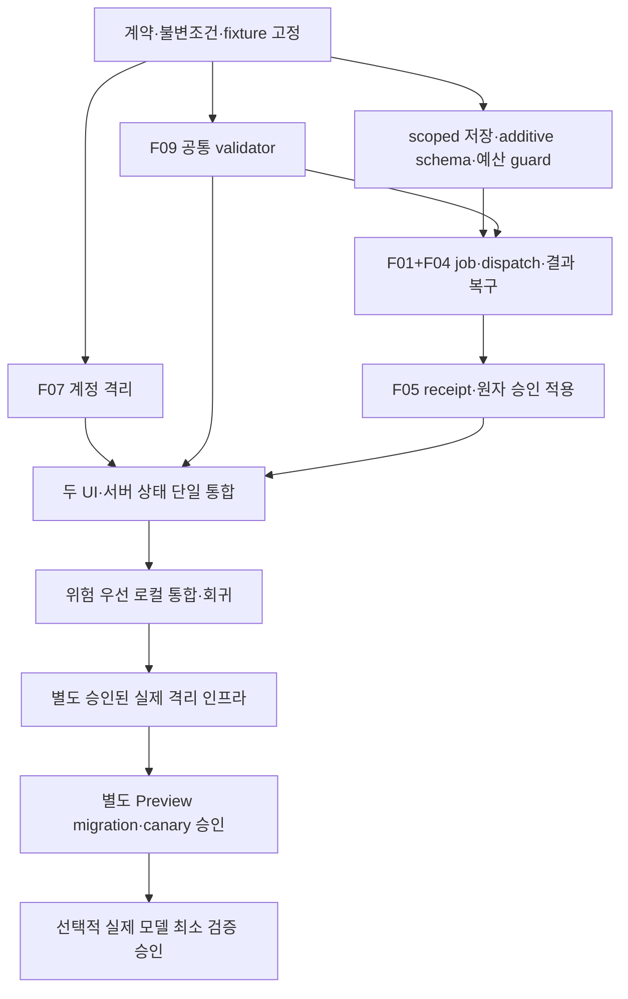

# BEYOND Phase 2 — 시간 최적화 구현 계획

2026-10-31 / Asia/Rangoon. **계획·기술 검토만 수행. 아래 구현·테스트·migration·배포는 이번에 실행하지 않았다.**

## 1. 핵심 요약

가장 짧은 안전 경로는 **공통 계약을 먼저 고정 → F07/F09 병렬 작업 → F01+F04 단일 백엔드 묶음 → 같은 head/job/receipt를 재사용한 F05 → UI 단일 통합 → 위험 우선 격리 검증 → 별도 승인된 실환경 검증**이다.

전역 CAS만 제거하거나 pending TTL만 추가하는 단독 수정은 하지 않는다. 전자는 예산 경쟁·legacy stale overwrite, 후자는 불명 provider 결과의 재호출/환불을 초래할 수 있다. 생성 후보 보관과 승인 적용을 분리하고, 성공하지 않은 상태를 성공으로 표시하지 않는다.

시간을 줄이는 방법은 새 프레임워크/서비스/cron 없이 기존 도구와 Phase1 fixture를 재사용하고, 공통 파일은 단일 통합 단계에서 수정하며, additive schema를 한 묶음으로 검토하는 것이다. 검증 생략·무료 한도 상향·기존 데이터 정리는 시간 단축 수단이 아니다.

## 2. Phase1 이후 현재 코드 확인

### 읽은 자료·누락

지정된7개 자료가 모두 존재한다: `BEYOND_PHASE1_SAFETY_DESIGN.md`, `BEYOND_SYSTEM_STABILITY_AUDIT.md`, `BEYOND_INTEGRATED_AUDIT_1-5.md`, `AGENTS.md`, `DECISIONS.md`, `STATUS.md`, `NEXT_SESSION.md`. Phase1의 분석·결정·관련 단락과 최신 handoff를 재사용하고 현재 함수/테스트 계약만 대조했다. 거대한 역사 기록을 새 원인 분석으로 반복하지 않았다. 누락 자료 없음.

branch main, HEAD `f4585907ecb8158eafd61cc769c4c31e94d102c0`. Phase1 시작 기준296개 기존 파일과 현재 SHA-256 대조 결과 **변경0개**. 추가된 것은 Phase1 설계 보고서 하나다. 따라서 해당 기준에 포함된 제품 코드·기존 감사/운영 문서는 Phase1 이후 달라지지 않았다. 이번 시작 파일 기준선은297개이며 dirty/untracked를 보존한다.

|대상|현재 함수/위치 확인|현재 판정|
|---|---|---|
|F07|cloudWorlds.ts hydrate/fetchWorld/upload/persistWorld, AccountProvider.reload, sessionScope, uploadAssets.operation|authEpoch 없음, 쓰기 전 stale guard가 충분하지 않음. Phase1 재현 근거 유효.|
|F09|WorldImageEditor.generate, WorldCompanion.generate, world-editsAPI actionType/protectedObjects|legacy actionType 생략과 보호 차이 유지.|
|F01|d1-store.openD1Store/flush, handler, world-editsAPI final flush|전역 revision·snapshot·최종 후보 commit 충돌 구조 유지.|
|F04|workers-ai.reserve/releaseUnstarted, companionContext|내구 lease/복구 protocol 미구현. 불명 pending 유지.|
|F05|world-editsAPI approve, WorldCompanion.decide|승인 ledger와 world/progress의 별도 저장 유지.|

Phase1 임시 테스트·최종 로그·격리 계측이 존재하며 당시39/39(현행 위험 재현8·설계 모형30·격리1)임을 읽어 확인했다. **이번에 재실행한 결과가 아니다.** 코드/원격 환경 변경이나 새 runtime/AI 검증 없음. 실제 사용량·현재 배포·요금제를 이번에 조회했다고 주장하지 않는다.

## 3. F07·F09 병렬 처리 가능 범위

**가능하되 계약 고정(C00) 이후에만 시작한다.** 실제 병렬 구현이나 agent/branch 생성은 이번에 하지 않는다.

|작업 레인|독립 소유 파일·범위|공유 지점|
|---|---|---|
|A07 계정 격리|sessionScope/AccountProvider/cloudWorlds/uploadAssets·인증 transport helpers·전용 테스트|불변 AccountContext와 전송 guard 인터페이스를 제공.|
|A09 편집 계약|새 shared/edit-contract.mjs(제안)·요청 타입·validator·계약 corpus|serializer가 AccountContext를 직접 구현하지 않고 기존 guarded transport를 호출.|
|백엔드 B10→B11→B12|native scoped 저장/예산/job/result/approval|A09 validator를 호출하고 기존 서버 auth 함수를 재사용.|
|I20 UI 통합 — 단일 담당 단계|WorldCompanion.tsx, WorldImageEditor.tsx, workersDialogue/aiErrors의 최종 연결|이 파일들을 A07/A09 양쪽에서 동시에 수정하지 않음.|

A07/F09 설계는 독립적이나 실제 요청 전송과 승인 UI는 결합된다. F09에서 별도 인증/에러/작업ID 구현을 만들지 않는다. B10의 schema/예산 검토는 A07/A09와 병행할 수 있지만 B11 연결은 공통 validator와 저장 계약이 준비된 뒤 한다.

## 4. F01·F04·F05 통합 구현 순서

### 공통 상태·정체성

- operationId는 actor+world에 결합된 안정 ID. 기존 requestId를 wire alias로 받을 때 **동일 값만 허용**하며 서버가 재시도마다 새 ID를 만들지 않는다. 같은 ID의 다른 actor/hash는 거절한다.
- `(ownerKind,ownerId,worldId)` image head revision, member world revision, source parent/hash, target ID/position을 구분한다. client revision은 힌트가 아니라 서버 조건 검증 대상이다.
- QUEUED/RUNNING/SUCCEEDED/FAILED/CANCELLED/EXPIRED/RECOVERY_REQUIRED와 provider phase·비용 확정 여부를 분리한다. SUCCEEDED는 후보 검토 가능이지 승인 완료가 아니다.
- dispatch marker를 provider 전에 내구 commit. marker 이후 종료·timeout은 자동 재호출하지 않는다. lease 만료만으로 provider 취소나 예약0을 주장하지 않는다.
- 결과 객체와 후보 metadata를 보관하는 commit은 world를 적용하지 않는다. 다른 세계 쓰기/같은 세계 변경이 있어도 결과를 지우지 않고 review용으로 남긴다.
- F05는 기존 job/result/head를 참조하는 PREPARED/APPLIED receipt만 추가한다. 중복 승인 결과를 읽을 때 world revision을 다시 증가시키지 않는다.

### 승인 transaction의 필수 경계

fresh session/owner/status/CSRF 검증 후 D1 atomic batch 내부 guard로 world/head/source/target 조건을 확인한다. world snapshot/revision·head·승인 ledger projection·receipt APPLIED를 함께 commit한다. UPDATE0건을 batch 밖에서 발견하고 이미 반영된 다른 변경을 되돌릴 수 있다고 가정하지 않는다.

Tigris는 D1 transaction 밖이다. 승인 전 검증된 immutable result receipt가 필요하며 누락/hash 불일치면 적용하지 않는다. PREPARED 저장만 성공한 경우202/미반영으로 보여준다. APPLIED 뒤 응답 유실이면 같은 receipt를 조회하고 추가 적용/모델 호출은 하지 않는다.

### 놓치면 안 되는 구현 의존성

1. **legacy stale overwrite:** native 성공 쓰기도 cf_state를 증가시킨다. native는 unrelated global revision을 승인 조건으로 삼지 않되 기존 snapshot writer는 stale이면 거절되게 한다. 구/신 모든 writer를 함께 검토한다.
2. **예산의 단일 진실:** 원자 입장을 구현하기 전에 새 counter와 old ledger가 따로 입장하지 않도록 결정한다. 초기 최소 경로로는 기존 ledger를 authoritative로 유지한 **transaction 내 집계 조건 guard+job/예약 INSERT**를 우선 검토한다. Phase1의 별도 day counter는 필수 전제로 확정하지 않는다. counter가 실제로 필요하면 전체 writer 동기화·초기화·롤백까지 C00/B10에서 한 번에 결정한다.
3. **과거 비용 보정:** JS budgetPool/accountedReservation과 SQL 입장 계산의 parity가 선행된다. world-vision/retry pool,31.42 역사 보정, pending/오류 비용, rejected-success count, UTC 경계를 누락하지 않는다. D1 SQL 표현·성능이 검증되기 전 구현 확정/활성화 금지.
4. **대화도 같은 world.version을 변경:** 신규 job 상태는 server job에서 읽는다. 생성 후 AWAITING_APPROVAL 같은 상태만 저장하려고 world를 다시 증가시키는 현 UI 동작은 I20에서 정리한다. 승인 전 대화는 먼저 저장하고 그 응답의 world version으로 admission한다. 최신 대화와 원본 Starter를 덮지 않는다. 중간에 다른 실제 world 변경이 있으면 일단409/재검토가 안전한 기본이다.
5. **로그아웃 뒤 결과:** 이미 승인된 dispatch의 내부 결과 저장은 원래 세션 만료만으로 삭제하면 안 된다. 내부 attempt fence/owner 존재·cleanup 상태로 검증하고 A 소유로 보관한다. 사용자 승인·노출은 fresh session을 요구한다. 삭제 cleanup과 in-flight 결과의 fence는 schema 승인 전 확인한다.

## 5. 파일별 수정 예정 위치·함수

아래는 **향후 수정 예정**이며 이번에 생성·수정하지 않았다.

|파일|함수/예정 변경|
|---|---|
|src/features/account/sessionScope.ts|capture/assert/invalidate account context, authEpoch·tab invalidation; 기존 namespace 보존|
|AccountProvider.tsx|reload sequence,401/session 교체/logout invalidation, 동일 A 재로그인|
|cloudWorlds.ts|memberAPI/hydrate/fetchWorld/refreshWorlds/upload/persistWorld/persistSidecar/importLegacy/retryPending 전 경계 guard|
|src/features/creation/uploadAssets.ts|database/operation의 captured namespace·transaction 취소 경계|
|workersDialogue.ts·authorAccess.ts|resolveAISession/requestCompanion/requestText/author verify의 context 검증|
|shared/edit-contract.mjs — 제안|공통 요청 규격·정규화·오류 code·operationId alias; 인증 대체 아님|
|cloudflare/ai-jobs.mjs — 제안|native job/head/result/approval 저장과 scoped transaction; 하위 파일 분리는 실제 복잡도가 생길 때만|
|cloudflare/handler.mjs·read-api.mjs|native route dispatch·owner-scoped job/receipt GET, 읽기의 inference/예약 부작용 금지|
|cloudflare/d1-store.mjs|legacy cf_state 호환 경계. 전역 guard를 무작정 제거하지 않음|
|cloudflare/workers-ai.mjs|policy/예약/settlement·공통 ledger 입장 계약, 전 모델 경로 parity|
|cloudflare/world-edits.mjs·world-edit-inference.mjs|공통 validator·동일 ID 조회·dispatch fence·결과 보관·원자 approve|
|cloudflare/user-worlds.mjs|member world revision/approval 참조 연결, stale save guard 유지|
|cloudflare/companion-context.mjs|세계별 상태 조회, RECOVERY_REQUIRED 표시, 오래된 세계 LIMIT 계약 보존/대조|
|WorldCompanion.tsx·WorldImageEditor.tsx|동일 serializer/transport/승인 client. server 상태와 UI 메시지 연결|
|aiErrors.ts|같은 오류 code를 공통 매핑, quota·CPU·복구/갱신 필요 구분|
|cloudflare/schema.mjs·migrations/<차기번호>.sql — 향후|최종 DDL 승인 후 한 additive 묶음. **현재 파일 생성 금지**|
|cloudflare/member-management.mjs|새 job/head/receipt 참조가 기존30일 cleanup을 막거나 누락되지 않게 최소 호환. 삭제 정책 확대 금지|

새 프레임워크/queue/DO/cron은 최소 경로에 포함하지 않는다. 기존 모델·합성 알고리즘·디자인 전면 개편도 범위 밖이다.

## 6. 공통 모듈·테스트 재사용

|공통 기능|재사용/확장|중복 방지|
|---|---|---|
|계정 컨텍스트|기존 sessionScope/AccountProvider/cloudWorlds에 추가|두 editor가 별도 authEpoch를 가지지 않음.|
|서버 인증|user-auth의 세션/owner/CSRF와 기존 admin allowlist|client role flag를 인증으로 사용하지 않음. DB commit 직전 fresh guard 유지.|
|요청·오류·ID|shared edit-contract + aiErrors/readAIResponse|UI별 actionType 추정/새 operation ID/오류 문자열 중복 금지.|
|job/result/approval|단일 ai-jobs repository와 동일 head/receipt DTO|F05용 두 번째 후보 저장소·상태 머신을 만들지 않음.|
|비용 정책|workers-ai policy/budgetPool/accountedReservation 규약|image/text/old ledger/new job 이중 예약·차감 금지.|
|fixture|TestD1/TestMedia·기존 codecs·가짜 clock/deferred/transport 차단|*.test.mjs를 helper처럼 import해 중복 테스트가 등록되는 구조 피함.|

Phase1 `/tmp/beyond-phase1-safety-qUsd5udV/safety.test.mjs`의8개 현행 재현과30개 설계 사례를 출발점으로 쓴다. F07 실제 구현 테스트는 unsafe 동작을 기대하던 assertion을 안전한 결과로 전환한다. 기존 전역 store의 legacy CAS 시험은 계속 유지하고 **새 native 경로의 세계별 성공 시험**을 추가한다. mock 설계 모형만 다시 돌려 제품 수정 검증으로 대체하지 않는다.

기존 `cloudflare/tests/{ai-limit,companion-actions,read-api,image-cpu}.test.mjs`, `src/tests/{ai-errors,apiResponse}.test.ts`, `tests/{world-companion,world-loading-recovery,member-accounts,world-image-editor}.spec.ts`에서 목적이 같은 assertion을 확장한다. fixture 하나를 공유하고 실패 이벤트 위치/actor/원본 hash를 parameterize한다. 이미 통과한 leaf 검사는 관련 변경이 없으면 반복하지 않고, 최종 통합 변경은 영향받는 묶음만 다시 실행한다.

## 7. Additive migration·롤백

F07은 DB schema 없이 가능. F09의 기본 검증도 대부분 가능하지만 신규 revision/job 필드는 B10과 맞춰 활성화한다. F01/F04/F05에는 job/head/approval의 내구 자료가 필요하므로 **additive migration 필요**가 현재 계획이다. 최종 이름·열·제약은 C00 승인 전 미확정이다.

초기 최소안은 ai_world_heads/ai_jobs/ai_approvals와 기존 ledger 참조. 일별 counter/이벤트 테이블을 추가할지는 ledger atomic guard의 parity·성능 확인 후 고정한다. 중간에 schema를 여러 번 바꾸지 않도록 F05 receipt와 admin legacy 소유 구분까지 첫 검토에 포함한다.

원칙:

- 기존 world·Starter·승인·pending 행을 UPDATE/DELETE하는 backfill은 기본안에 없음. 새 head 초기화가 필요하면 actor별 기존 승인 source를 읽고 검증하며 충돌·다중 활성·누락 key를 자동 추정하지 않는다.
- user_worlds는 owner+id, admin legacy는 ownerKind+owner+world scope로 구분한다. admin browser-only 세계를 자동 member world로 migration하지 않는다.
- 새 참조/FK가30일 cleanup을 실패시키거나 새 metadata를 남기는지 격리 검증한다. cleanup 정책 변경·실계정 삭제는 별도 승인이다.
- ledger 기반 입장은 SQL guard/유일 ID/중복 상태 전환까지 한 atomic batch에서 처리한다. old/new budget writer 혼재를 검증하지 못하면 신규 입장 활성화 금지.

**롤백은 DROP/행 삭제/원본 복구 덮어쓰기가 아니라 새 쓰기 입장 정지+호환 read 유지**다. APPLIED 이후 user revision을 과거로 되감지 않는다. 기존에 없던 테이블은 남기고 새 job의 결과/예약/receipt를 보관한다. unknown/in-flight가 있으면 안전한 recovery reader/writer를 유지한다. receipt를 모르는 오래된 Worker로 즉시 downgrade하거나 missing-actionType 보호 우회를 다시 켜는 것은 롤백이 아니다.

## 8. Tigris 변경 필요 여부

기존 key 구조·객체 이동/rename/overwrite/delete는 필요 없다. 같은 original/candidate 보존·If-None-Match를 유지한다. 선택적 immutable result manifest는 원격 저장 후 DB metadata 실패 복구를 위한 **새 key**로만 추가한다. 최종 저장 증거가 DB receipt만으로 충분한지 B11에서 판단하되 RAM-only 결과를 내구화했다고 간주하지 않는다.

hash/owner/source/attempt fence가 맞는 객체만 재사용한다. Tigris와 D1은 분산 원자 transaction이 아니므로 부분 실패는 RECOVERY_REQUIRED로 표시한다. 신뢰할 백업이 없다면 같은 모델을 몰래 다시 호출하지 않는다. orphan/옛 pending 정리는 별도 증거·승인 없이는 수행하지 않는다.

## 9. 사용자·세계·이미지·승인 기록 영향

**이번 영향0:** 새 계획 파일 외 기존 파일·DB·미디어·계정·정산을 변경하지 않았다.

향후에도 기존 사용자 ID/hash/session 정책, world ID/원본 Starter hash, object ID/좌표, 승인·revision 이력은 유지한다. 새 approval은 동일 actor/world/candidate를 참조하고 duplicate 적용은0이어야 한다. UNKNOWN pending은 읽기 전용 상태 투영부터 시작하며 오래됐다는 이유만으로 만료/환불하지 않는다.

호환 주의:

- member world는 D1 적용 원자성을 목표로 한다. admin browser-only world의 로컬 대화/저장까지 D1 transaction에 넣을 수는 없다. ‘서버 이미지 적용’과 ‘로컬 동기화’를 구분하는 지원 범위를 승인받는다.
- F07 stale 응답 차단은 이미 보관된 A namespace/초안을 지우지 않는다. A→B→A의 새 epoch에서 A 서버 자료를 정상 복원한다.
- 기존 후보는 read adapter로 계속 조회한다. 구 후보 승인 bridge가 필요하면 새 receipt로 참조하되 실제 사용자 승인을 거친다. 기존 unknown pending을 새 job으로 복제·재추론하지 않는다.
- 기존 client의 actionType 누락은 명확한 업데이트 안내 후 쓰기를 거절한다. 데이터를 못 읽게 하거나 조용히 unsafe fallback하는 방식은 쓰지 않는다.

## 10. 테스트 순서·통과 기준

**새 테스트는 이번에 실행하지 않았다.** 아래는 향후 구현 승인 뒤의 순서다. 코드 존재/메모리 DB 통과/실제 Cloudflare 검증을 구분한다.

|순서/ID|실행할 검사·재사용|필수 통과 기준|
|---|---|---|
|1 T-ACCOUNT|Phase1 F07 확장: 지연 A read/upload/world PUT, logout/B, A→B→A, 두 탭·세션 만료|B cache/IDB/API에 A 반영0, stale 전송0, 새 A 복원 성공. 서버 session/owner/CSRF 유지.|
|2 T-CONTRACT|두 editor 같은 입력: occupied/protected/missing actionType/wrong target/revision/구 client|오류 종류·검증 결과 동일. 잘못된 요청의 모델0·예약0. 보호 우회 fallback0.|
|3 T-CAS-BUDGET|다른 세계 동시 저장, 같은 세계 경쟁, old snapshot 시작→native commit→old flush, old/new 예약 경쟁|다른 세계 성공, 동일 세계 충돌 검출, old stale overwrite0, 무료 pool/actor 한도 초과0.|
|4 T-JOB|동일 operationId·다른 hash/actor, dispatch 전후 종료·지연/취소/만료|중복 inference0, QUEUED와불명RUNNING 구분, unknown 예약 유지, 자동 재호출0.|
|5 T-RESULT|provider 성공 뒤 객체/manifest/metadata 저장 단계별 실패·응답 유실|내구 결과가 있으면 재사용, 없으면 복구 필요. 원본/후보 임의 삭제·가짜 성공0.|
|6 T-APPROVAL|D1 guard/UPDATE/revision/receipt 중 오류, duplicate approval, APPLIED 뒤 응답 유실·재접속|원자 rollback 또는 정확한 APPLIED receipt, revision1회 증가, PREPARED가 활성화되지 않음.|
|7 T-PRESERVE|기존 Starter/승인 이미지 hash·바깥0픽셀, legacy DTO/구 후보/과거 pending·cleanup 참조|hash 동일, 원본·기존 승인·pending 유지, old ledger/new job 이중 차감0, 공유 콘텐츠 보존.|
|8 T-UI|기존 local member Playwright·두 editor·job/receipt 재연결·모바일|실제 서버 상태와 메시지 일치, 불명 성공 약속0, stale scope 복원0, 정상 생성·승인·거절 유지.|
|9 T-REMOTE|별도 승인된 독립 D1/Tigris/Worker sandbox, AI mock, 소수 결정적 경합·fault|D1 실제 batch·Tigris 조건 저장·Worker 종료/재조회 확인. 메모리 결과와 구분. 실제 서비스 대량 부하 금지.|
|10 T-PREVIEW/AI|별도 migration/배포 승인 후 canary; 모델 검증은 추가 승인·무료 여유 있을 때만|기존 기준 hash 불변·같은 receipt 재접속. 모델 호출 횟수/실제 사용량/예약 분리. 불명 provider 강제 재시도0.|

합격 gate: T-ACCOUNT~T-PRESERVE의 실패 경로가 먼저 통과한 뒤 UI·인프라로 확장한다. 초기에 모든 browser/full suite를 반복 실행하지 않는다. 변경 없는 AI model/mask decoder를 다시 검증하려고 이미지를 반복 생성하지 않는다.

## 11. 예상 병목·불확실성

|항목|결정/확인 필요|진행을 막는 gate|
|---|---|---|
|native ledger atomic 집계|역사 비용 보정·UTC·실패/불명 비용·old writer parity와 실제 D1 SQL 지원/시간|B10 완료·원격 활성화 전. 반쯤 독립 counter로 우회 금지.|
|승인 world version|대화-only 변경·image head·stale client 저장의 경계|C00/I20에서 commit 순서 고정. 자동 merge/rebase는 기본 범위 제외.|
|admin legacy world|server image receipt와 local progress의 서로 다른 보장|C00에서 지원 범위 결정, member와 동일 원자성 약속 금지.|
|다중 탭 cookie|BroadcastChannel/storage 알림은 지연 가능; capture CSRF/session과 owner 응답 검증 필요|A07 실제 local browser 테스트. 클라이언트만으로 서버 인증 대체 금지.|
|dispatch/result crash window|provider exactly-once·RAM 유실을 보장 못함|B11은 RECOVERY_REQUIRED를 정상 결과로 수용해야 함.|
|새 metadata와30일 cleanup|새 FK/owner prefix·in-flight completion의 fencing|B10 schema 승인/격리 lifecycle 검증 전 remote migration 금지.|
|Free CPU/Memory·실제 비용|메모리 SQLite/Map 성능이 Cloudflare와 다름; 실제 플랜/Tigris billing도 미확인|R40 자원·비용 권한 확인 전 생성/배포 금지.|
|구 client·rollback|이전 writer/old UI가 보호·receipt를 모를 수 있음|read 호환+새 쓰기 정지의 안전한 롤백을 먼저 검증.|

정확한 시간/일수는 위 gate가 해소되기 전 확정할 근거가 없다. 난이도는 아래 작업별로 표시하며, 전체 소요를 줄이려고 불확실성을 성공으로 가정하지 않는다.

## 12. 최단 안전 구현 경로 — 작업 카드

### C00 — 계약·테스트 기준 고정

- **작업 ID:** C00
- **대상 문제:** 전체5개와 경계 호환
- **수정 대상 파일:** 설계·테스트 fixture 계약; 이후 shared edit-contract/sessionScope/ai-jobs의 인터페이스 정의
- **선행 조건:** 로컬 구현 범위 승인, 기존 dirty/untracked 해시 기준선
- **구현 내용:** actor/epoch·operationId·head/world revision·job/result/approval DTO·오류·legacy 지원 범위·예산 single source 결정. 실제 코드 변경은 승인 후.
- **테스트 방법:** Phase1 사례를 제품 assertion과 reference model로 분리, 순수 corpus/SQL parity 계획
- **완료 조건:** 두 UI·백엔드가 같은 계약을 참조하며 schema 재설계가 필요한 미결정 항목을 명시
- **데이터 영향:** 문서/격리 fixture만, 원격0
- **롤백 방법:** 설계안을 철회하되 기존 파일/데이터 보존
- **예상 난이도:** 중간

### A07 — 계정 컨텍스트와 쓰기 전 격리

- **작업 ID:** A07
- **대상 문제:** F07
- **수정 대상 파일:** sessionScope, AccountProvider, cloudWorlds, uploadAssets, 인증 transport helper
- **선행 조건:** C00의 capture/assert/invalidate 계약
- **구현 내용:** userId/authEpoch/request generation, 불변 namespace, 전송 전·응답 후·IDB/sidecar/cache commit guard, logout/401/새 세션 무효화, tab 알림과 서버 검증 결합
- **테스트 방법:** T-ACCOUNT, Phase1 두 current F07 사례를 안전 결과 assertion으로 전환; local browser 두 탭
- **완료 조건:** A→B→A와 병렬 완료에서 다른 계정 반영/전송0, 정상 A 재접속·admin/legacy 경로 유지
- **데이터 영향:** 기존 캐시 이동/삭제0; stale commit만 차단
- **롤백 방법:** 취약한旧 guard로 되돌리는 대신 해당 쓰기 pause+읽기 유지. 기존 namespace/초안 보존
- **예상 난이도:** 높음

### A09 — 공통 편집 검증·직렬화

- **작업 ID:** A09
- **대상 문제:** F09
- **수정 대상 파일:** shared/edit-contract(제안)·validator/serializer 테스트; UI 최종 배선은 I20
- **선행 조건:** C00, server 권한 검사 재사용
- **구현 내용:** 필수 actionType/operationId/target/revision·좌표·보호 영역 계약. 누락/오류는 모델·예약 전 거절. old client 업데이트 안내 정의
- **테스트 방법:** T-CONTRACT·기존 mask/보호 fixture, 두 UI adapter parity
- **완료 조건:** 동일 입력 동일 검증, 잘못된 요청 모델0/예약0, protected object 우회0
- **데이터 영향:** 기존 원본·승인 불변; 구 client 쓰기 제한은 명시된 호환 변화
- **롤백 방법:** 보호를 끄지 않고 생성 입장 pause/이전 호환 read 유지
- **예상 난이도:** 중간

### B10 — Native scoped 저장·schema·예산 기초

- **작업 ID:** B10
- **대상 문제:** F01+F04, F05의 선행 구조
- **수정 대상 파일:** ai-jobs(제안), handler/read-api, workers-ai, d1-store 경계, schema/단일 additive migration(향후), cleanup 호환
- **선행 조건:** C00의 head/job/receipt·예산·legacy/cleanup 결정; migration 작성 승인
- **구현 내용:** scoped 조건 guard·job uniqueness·head·원자 budget 입장, cf_state 증가 호환, old ledger single source. F05 필드를 처음 schema 검토에 포함
- **테스트 방법:** T-CAS-BUDGET·실제 코드 대상으로 TestD1, 역사 quote/UTC/취소·거절·unknown parity, additive 재실행/구 reader/cleanup fixture
- **완료 조건:** 다른 세계 독립·same-world guard·old snapshot 덮어쓰기0·old/new 예약 경쟁 초과0. schema 한 묶음으로 검토 가능
- **데이터 영향:** 격리 DB additive만; 실환경은 아직0. 기존 행 backfill/정산 기본0
- **롤백 방법:** 신규 입장 중단·테이블 유지·호환 reader 유지. DROP/과거 revision 되감기 금지
- **예상 난이도:** 높음

### B11 — 내구 job·dispatch·결과 복구

- **작업 ID:** B11
- **대상 문제:** F01+F04 통합
- **수정 대상 파일:** ai-jobs, world-edits, world-edit-inference, workers-ai, companion-context/read-api
- **선행 조건:** B10·A09
- **구현 내용:** same-ID 기존 결과 우선, dispatch marker/fence,7상태·provider phase, immutable 결과/선택적 manifest, metadata 복구. 세계 변경과 무관하게 후보 보관
- **테스트 방법:** T-JOB/T-RESULT, Phase1 지연 mock과 endpoint 직접 호출을 실제 새 repository로 전환
- **완료 조건:** dispatch 이후 종료/metadata 실패는 자동 재호출·불명 환불0; 내구 결과만 재사용. 정상 후보와 원본 보존
- **데이터 영향:** 신규 job/receipt/객체만; 과거 pending은 read-only 관측
- **롤백 방법:** 새 dispatch 정지, in-flight 결과/예약/복구 접근 보존. 결과 삭제로 정리하지 않음
- **예상 난이도:** 높음

### B12 — Receipt 기반 승인과 world 원자 적용

- **작업 ID:** B12
- **대상 문제:** F05, F01 revision 재사용
- **수정 대상 파일:** ai-jobs approval, world-edits approve/reject, user-worlds/read-api
- **선행 조건:** B11의 검증된 candidate·B10 head/approval schema
- **구현 내용:** PREPARED/APPLIED, fresh auth/owner·world/head/source/target guard와 revision/snapshot/ledger mirror를 D1 단일 batch. duplicate receipt 결과 조회
- **테스트 방법:** T-APPROVAL/T-PRESERVE; 각 statement 실패·lost response·same-world 두 승인
- **완료 조건:** 미승인 적용0·APPLIED revision 정확히1회·부분 실패 시 재접속으로 상태 확인·기존 원본/이력 불변
- **데이터 영향:** 명시적 승인에만 새 revision; Starter hash 유지. 실데이터 시험은 승인 전 금지
- **롤백 방법:** 승인 입장 중지·APPLIED 이력/새 revision 유지·read/recovery 유지. 적용된 사용자 세계를 되돌리지 않음
- **예상 난이도:** 높음

### I20 — 두 UI와 상태 조회 단일 통합

- **작업 ID:** I20
- **대상 문제:** F07/F09와 F01/F04/F05 접합부
- **수정 대상 파일:** WorldCompanion, WorldImageEditor, workersDialogue, aiErrors, account hydrate 연결
- **선행 조건:** A07·A09·B12
- **구현 내용:** 같은 guarded transport/serializer/operationId 사용; server job/receipt가 상태의 진실. 불필요한 task 상태용 world 추가 저장 제거. 승인 후 응답의 최신 envelope를 epoch 검증 후 반영
- **테스트 방법:** T-UI·legacy/new adapter parity, 기존 local member Playwright 확장
- **완료 조건:** 두 경로 같은 오류/보호·PREPARED를 성공으로 표시하지 않음·계정 전환/모바일/재접속 유지·기존 정상 기능 보존
- **데이터 영향:** 로컬 초안·계정 namespace 보존, unrelated pending clear 금지
- **롤백 방법:** 새 쓰기 비활성+읽기/복구 유지, unsupported client에 update 안내
- **예상 난이도:** 중간

### T30 — 위험 순서 로컬 통합 gate

- **작업 ID:** T30
- **대상 문제:** 전체5개 회귀
- **수정 대상 파일:** 기존 관련 Node/Vitest/Playwright 테스트와 공유 fixture만
- **선행 조건:** 각 leaf 검사 통과·I20
- **구현 내용:** 10절1~8 순서로 fault schedule 재사용, 실제 새 제품 코드를 대상으로 검증. Reference 모형은 보조 자료
- **테스트 방법:** in-memory/별도 임시 DB·Map·provider mock·외부 transport 차단
- **완료 조건:** 위험 경로 전부 통과·네트워크/실제 모델0·보존 hash 불변·실패 로그와 한계 명시
- **데이터 영향:** 격리 DB/테스트 profile만
- **롤백 방법:** 실패 단계 구현을 재검토, 원격 활성화 gate 폐쇄; 제품 기준선/기존 사용자 자료 유지
- **예상 난이도:** 중간

### R40 — 실제 격리 인프라 검증(별도 승인)

- **작업 ID:** R40
- **대상 문제:** 메모리 DB만으로 검증 못한 F01/F04/F05·저장 의미
- **수정 대상 파일:** 승인된 테스트 전용 설정/계측 도구, 제품 수정은 필요한 결함만 재승인
- **선행 조건:** T30·계정 권한/무료 자원 여유·테스트 전용 Worker/D1/bucket 또는 명시적 격리 자원 승인
- **구현 내용:** Production/운영 Preview 데이터와 분리된 실제 Cloudflare/Tigris에서 AI mock으로 transaction·If-None-Match·소수 결정적 중단/재조회 검증. 부하/실제 AI 없음
- **테스트 방법:** T-REMOTE. 대상 allowlist·네트워크/원본 hash·D1 결과 증거 기록
- **완료 조건:** 실제 D1/Tigris/Worker 검증 통과와 미검증 항목 구분. 자원 분리 못 하면 UNVERIFIED로 중단
- **데이터 영향:** 승인된 독립 테스트 자원에만 생성/쓰기. 현재 단계에서는0
- **롤백 방법:** 테스트 새 입장 중지·원본/receipt 보존. 정리는 생성 범위와 명시적 승인을 확인한 뒤만
- **예상 난이도:** 높음

### R41 — Preview additive 적용·canary(별도 승인)

- **작업 ID:** R41
- **대상 문제:** 실제 운영 호환성·롤백
- **수정 대상 파일:** 검토된 Preview migration/worker/assets와 릴리스 체크리스트
- **선행 조건:** R40·변경 묶음/백업·schema·구 client/rollback 계획 승인
- **구현 내용:** 기준 해시/배포/기존 pending 보존 확인, additive 적용 후 read 호환 우선. 새 입장/승인은 검증 gate 뒤에만 활성화
- **테스트 방법:** 승인된 소수 canary 사용자/세계만. old snapshot·구 후보·기존 Starter/승인 hash 대조
- **완료 조건:** 기존 자료 불변·지원 client 정상·복구 상태 확인·실제 사용량 보호. old unknown pending은 임의 정산하지 않음
- **데이터 영향:** 승인된 Preview만; Production0
- **롤백 방법:** 새 입장/승인 pause, schema/기록 유지, 안전한 호환 reader/recovery 유지. blind旧 Worker 복귀 금지
- **예상 난이도:** 높음

### R42 — 실제 모델 최소 확인(선택·추가 승인)

- **작업 ID:** R42
- **대상 문제:** 최종 실제 provider 연결 증거
- **수정 대상 파일:** 원칙적으로 제품 수정 없음; 검증 도구만
- **선행 조건:** R41·정당한 무료 잔여 예산·명시적 모델 호출 승인
- **구현 내용:** 가능하면 하나의 기존 흐름에서1회 Klein 후보를 생성하고 승인·동일 receipt replay·재접속에 재사용. 실제 provider 강제 중단/반복 호출 금지
- **테스트 방법:** 모델명/호출 횟수·wall/CPU 구분·원본/후보 hash·바깥 픽셀·승인 version/저장/재접속 기록
- **완료 조건:** 실제 모델 성공·후보·승인·저장을 분리 보고. 예산/접근 부족 시 미검증으로 남김
- **데이터 영향:** 승인된 검증 세계의 새 버전만; 기존 원본·승인·pending 보존
- **롤백 방법:** 추가 모델 호출 중단, 생성 결과·예약 유지, 승인 전이면 원래 세계 그대로. 임의 모델 교체/예산 확대 없음
- **예상 난이도:** 중간

## 13. 승인 경계·완료 보고

현재 허용 범위는 **계획 파일 작성**뿐이다. C00~T30 제품/테스트 구현 승인, migration 파일 작성 승인, R40 독립 자원/원격 시험 승인, R41 Preview migration·배포·canary 승인, R42 실제 모델 승인을 분리한다. 실제 pending 정산·원본/승인 데이터 정리·legacy 세계 자동 이관은 이 계획의 기본 실행에 포함하지 않는다.

**최단 안전 경로:** C00 → 병렬 A07/A09 및 B10 기초 → B11 → B12 → I20 → T30. 실환경은 R40/R41/R42 별도 gate다. 파일별 ownership과 공통 fixture를 고정해 재작업을 줄이고, 통과한 검사를 목적 없이 반복하지 않는다. 미결정 schema/예산/legacy 범위를 감추고 일정만 단축하지 않는다.

이번 실행: 지정 자료/코드/기존 로그 읽기·파일 해시 대조만 수행. 테스트·migration 파일 생성/실행·D1/Tigris/AI 접속·예산 예약·계정 변경·Preview/Production 배포·Git 변경 작업 없음. 원격 환경 상태를 새로 확인했다고 주장하지 않는다. **종료 확인: 계획 파일 존재,13개 본문 절·11개 작업 카드·카드별 필수10항목 확인. 기존297개 파일 SHA-256 변경0·삭제0, 추가 파일은 이 계획 하나뿐이다.**

**계획 제출 후 중단. 실제 코드 수정은 별도 승인을 기다린다.**
