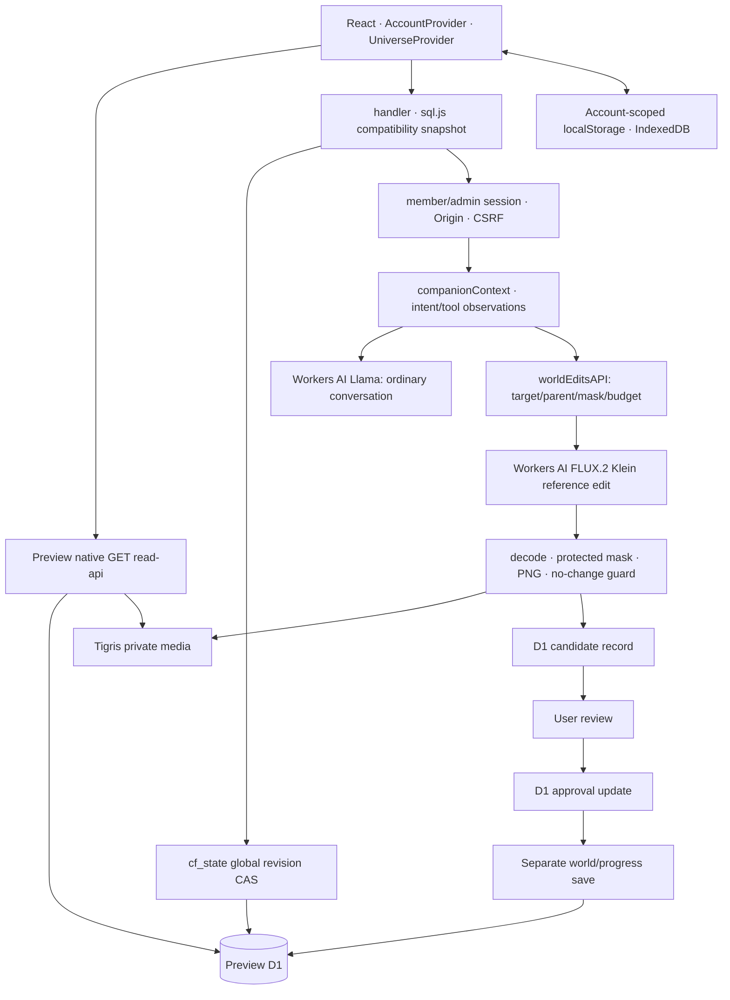
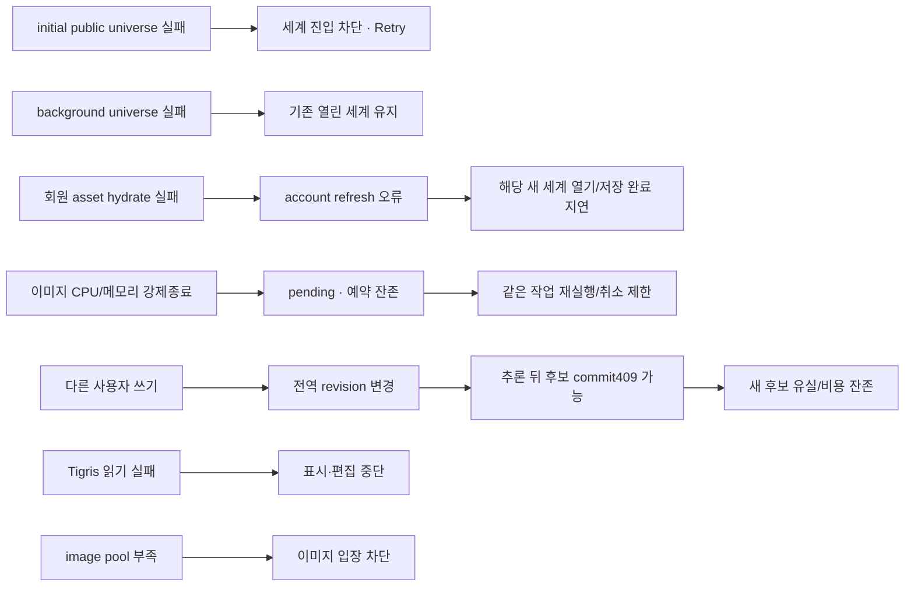

# BEYOND 전체 시스템 안정성 감사 — READ ONLY

감사일: **2026-10-31, Asia/Rangoon(MMT, UTC+06:30)**. 실환경 수치의 기준 시각은 **13:50 MMT / 07:20 UTC**이며 이후 파일 해시 표본 조회를 추가했다. 로그의 원래 UTC 시각을 병기한다.

## 1. 전체 시스템 안정성 요약

**판정: 제한된 Preview 실험에는 사용 가능하나, 30명 파일럿의 지속적 안정성·월 실제 청구 $0를 보장할 근거는 부족하다.** 원본 손상·타 계정 서버 권한 우회가 발생했다는 증거는 발견하지 못했다. 이는 P0 부재의 증명이 아니다. P1 구조적 위험이 여러 개 있다.

- **CONFIRMED — 현재 보존:** 기존72개 요청 행의 해시 동일, 보고 세계 원본 Starter의 메타데이터·실물 바이트 동일, revision1–49 존재. 샘플 승인 이미지의 원본·후보 해시도 일치.
- **CONFIRMED — 장애 이력:** 이미지 업로드의 `exceededCpu`, 스타일 편집·공개 캐릭터 조회의 HTML1102. Neurons 소진과 구분된다.
- **CONFIRMED — 코드 구조:** 모든 호환 SQL 쓰기가 하나의 전역 revision을 공유한다. 모델을 기다리는 동안 다른 요청이 쓰면 최종 후보 저장이 충돌할 수 있다. 전체 테이블 복사·20,000행 상한도 남아 있다.
- **CONFIRMED — 기능 공백:** UI 언어는 en/es만 활성이다. 5개 언어 지원 완료가 아니다. 건물 footprint·교량 접속부는 수학적 제약이 아닌 프롬프트/시각 검토에 의존한다.
- **UNVERIFIED — 비용:** 현재 Workers 구독 조회 권한이 부족하며 Tigris 청구·월 요청량도 미확인이다. 무료 한도와 내부 예약만으로 전체 청구 $0를 단정할 수 없다.

**감사 중 코드·설정·DB·미디어 변경, 배포, 로그인/로그아웃, AI 호출, 예약, 테스트용 세계 생성은 하지 않았다.** 생성한 파일은 이 보고서 하나뿐이다. STATUS/NEXT_SESSION 등 기존 문서도 수정하지 않았다. Production은 설정 GET만 수행했다.

분류: CONFIRMED=코드 또는 실제 증거로 해당 사실 확인, LIKELY=영향/원인은 추론, UNVERIFIED=부족, NOT_REPRODUCED=이번 감사에서 새 재현 없음, PASS=명시된 검사 범위만 정상. 정적 구조 확인을 실제 기능 성공으로 계산하지 않는다.

## 2. 아키텍처와 주요 데이터 흐름

실제 Preview는 D1+Tigris+AI 바인딩이다. 실제 Production Worker `beyond`의 읽기 전용 설정 조회에는 **Supabase 바인딩과 ASSETS가 있으며 DB/AI/BEYOND_STAGE는 보이지 않았다.** Production이 Preview와 동일한 D1/Tigris 구조라고 가정하면 안 된다. 로컬 `wrangler.cloudflare.production.review.jsonc`는 승인 대기 placeholder이며 실제 배포 설정의 증명이 아니다.

주요 진입점: `src/Root.tsx`, `src/App.tsx`, `src/admin/AdminApp.tsx`, `cloudflare/worker.mjs:8`, `cloudflare/handler.mjs:13`, `cloudflare/read-api.mjs:7`, `server/api.mjs`, `worker/`의 기존 Production 어댑터. `cloudflare/generated/`는 `generate-api.mjs`의 문자열 변환 산출물이다. 생성 원본/산출물/native GET 간 계약 일치가 회귀 위험이다.

## 3. 영역별 검사 결과

|영역|결과·확신|근거와 검사 범위|
|---|---|---|
|A Frontend/UI|PASS(정적 보존 경로), LIKELY(경합)|UniverseProvider는 background 실패 때 기존 children 유지. 초기 실패는 여전히 전체 진입을 막는다. AccountProvider 세션 확인 후 모든 세계/자산 hydrate; 한 자산 실패가 전체 refresh 완료를 막을 수 있음. 모바일 실제 검증은 과거 결과만 참조.|
|B 인증·권한|PASS(검토 범위), UNVERIFIED(실행 공격)|회원/관리자 별도 세션, 토큰 hash, credential version, 상태/만료·소유권·Origin/CSRF 검사 존재. 쿠키 HttpOnly/Secure, 회원 SameSite=Lax, 관리자 Strict. 정상401/403을 성공으로 변경하는 경로는 확인하지 못함. 이번 감사에서 로그인/침투 테스트 없음.|
|C World Core|PASS(현 저장 데이터), P1 위험|D1 원본·49개 revision 확인. 저장 CAS/요청ID, 초안 보존 있음. 전역 CAS·다중 탭 최신 상태·캐시 경합은 별도 위험. 사용자 세계 공개 공유 정책은 editorial public universe와 다름.|
|D Spatial Core|CONFIRMED 제한|정규화 좌표와 화면 cover 변환은 존재. 집 ID·승인 좌표 재조회 방어 있음. bbox/footprint/교량 양끝점/충돌 solver 없음. 서로 다른 좌표계 변환과 border clipping은 정적 검토만.|
|E AI Companion|CONFIRMED 부분 구현|의도는 주로 정규식. 일반 대화는 text API이고 이미지 호출은 UI action 경로. 기억은 최근 visitor30개 발췌+최근12개 대화이지 장기 요약 저장 엔진이 아님. 198개 이력 제한과 영/서 UI, 다국어 의도 범위 불균형.|
|F Creation/Edit|PASS(과거 실제 성공·현재 방어 코드), UNVERIFIED(재검증)|Klein 기본·참조504/출력512·합성·원본 별도·승인 유지. 보호영역/무변경 guard가 있음. 별장 수정 후 실제 새 성공은 없음. 레거시 편집 UI는 actionType을 생략하는 보호 차이가 있음.|
|G API/Workers|CONFIRMED P1|native GET는 sql.js를 피하지만 쓰기/여러 admin GET/이미지 관리에는 전체 snapshot·WASM 비용. 플랫폼 종료는 JS catch로 JSON화 불가. 1102/503 재발 가능.|
|H Persistence|PASS(현재 표본), LIKELY 위험|15개 회원 asset 행·12개 성공 edit 기록의 참조 key는 모두 bucket 목록에 있음. 99개 객체 전체 hash 감사는 하지 않음. 승인/sidecar 저장과 D1/Tigris 사이 원자성은 없음.|
|I Admin/Monitoring|CONFIRMED 범위 차이|Dashboard/Worlds/Characters/Connections/Analytics/Settings/Users/Content/Discoveries/Activity/Image Management 라우트 확인. 통계는 editorial/central/member scope가 다르며 Neurons·Tigris 청구 통합 계측은 아님. 실제 관리자 로그인/각 메뉴 UI 실행은 하지 않음.|
|J 무료 예산|CONFIRMED 내부 정책, UNVERIFIED 청구|text8000/image1000/service9000, 이미지 계정별3, 대화 계정별 강제30 제한 없음. 내부 예약과 계정 전체 실제 Neurons는 별개. 아래 운영 시나리오 참조.|

프런트 이벤트 cleanup·cancelAnimationFrame·renderer.dispose·일부 blob revoke는 확인했다(`WorldCompanion`, `AssetPreview`, `freeCosmos`). 모든 비동기 수명/메모리 누수가 없다고 증명한 것은 아니다. WorldCompanion의 늦은 starter blob 생성 후 cleanup 시점 차이 등은 별도 검증이 필요하다.

### 주요 발견 — 파일·함수·API·영향·재현·수정 방향

아래 정적 발견은 실제 요청 ID가 없으며 **이번 감사에서 재현 요청을 실행하지 않았다**. 실제 장애 ID는 5절에 별도 연결했다.

|ID/우선순위|발견과 근거 위치·함수·API|영향·확신·재현|권고 방향(미실행)|
|---|---|---|---|
|F01 P1|`cloudflare/d1-store.mjs:34` `flush()`의 전역 cf_state revision, `world-edits.mjs:83,103` reserve/final flush; 모든 호환 쓰기|CONFIRMED 구조, LIKELY 동시 작업 실패. 서로 다른 회원/세계의 쓰기도 장시간 모델 작업 commit을 무효화. 최종 저장 실패 catch가 새 후보 파일을 지워 완료된 추론 비용·후보를 잃을 수 있음. 원래 승인 이미지 삭제는 아님.|세계/작업 단위 조건부 트랜잭션·내구 작업 단계·결과 복구 설계. 모델 자동 재호출로 해결 금지.|
|F02 P1|`d1-store.mjs:10–20` `openD1Store()`, `handler.mjs:25–32` selectedTables; AI/관리자/로그인/업로드|CONFIRMED 전체 행 복사와20,000행 상한. 행 상한 검사는 D1 결과 수신 후이며 byte 한도 아님. 로그·계정·큰 세계가 누적되면 CPU/메모리 및 호환 경로 가용성 저하. 이번 부하 재현 없음.|나머지 경로도 scoped native 쿼리 검토, byte/페이지 상한, 보존 정책과 분리. 과거 기록 임의 삭제 금지.|
|F03 P1|`world-edits.mjs:78–103`, `workers-ai.mjs:70` png, `runtime-images.mjs`; `/api/user/assets`, `/api/ai/world-edits`|CONFIRMED 실제 CPU 실패 이력, LIKELY 이미지/WASM 메모리 압력. 2048²에서 original/full/maskRGBA/weights만 약64MiB, PNG scan까지 약80MiB+WASM/SQL/동시 요청; 실제 peak 미측정.|lossless 처리의 분할/메모리 수명·상한·기존 압축·source 참조 최적화 평가. Free에서 보장 가능한 크기·동시성 명시.|
|F04 P1|`workers-ai.mjs:20–50`, `companion-context.mjs:32–38`, `WorldCompanion.tsx:45`; AI pending|CONFIRMED 종료 불명 pending의 만료·복구 프로토콜 없음. 개별 작업은 계속 RUNNING/취소 불가, 당일 이미지 개수·예약 점유. 새 다른 작업까지 무조건 전부 차단하는 것은 아님. 현재 pending3개(오늘)·이전2개.|증거 기반 reconciliation/내구 상태/동일ID 결과 조회. Worker 종료를 provider 취소로 오해하거나 예약을 무조건 환불하지 않음.|
|F05 P1|`world-edits.mjs:44–53` approve, `WorldCompanion.tsx:50` decide; `/approve`와 `/api/user/worlds/:id`|CONFIRMED 승인 ledger와 대화/세계 sidecar는 별도 commit. 승인 성공 후 sidecar 실패 가능. 별도 retry 안내는 있으나 완전 원자성 아님. 이미지 승인 자체를 세계 revision 하나와 같은 것으로 보면 안 됨.|승인 영수증+세계 revision 연결, 재접속 시 server 상태로 일관되게 복구.|
|F06 P1|`companion-context.mjs:8,33` actor LIMIT100 **후** world 필터·anchors12개|CONFIRMED 정적. 다른 세계 편집이 쌓이면 오래된 세계의 대상/후보가 맥락에서 사라질 수 있음. native GET의 world 필터 후 LIMIT와 계약 차이. API `/api/ai/text`.|world 조건을 SQL에 포함, 실제 객체 상태 인덱스/페이지 계약 검토.|
|F07 P1|`src/features/account/cloudWorlds.ts:23–25` hydrate/fetchWorld, `AccountProvider.tsx:8` reload|LIKELY 브라우저 계정 scope 경합. await 중 로그아웃/계정 전환 후 currentUserId로 cache·sidecar·asset 저장할 수 있음. 서버 타 계정 접근 허용을 확인한 것은 아님. 이번 전환 재현 없음.|캡처한 account/session generation 검증과 취소를 모든 await/캐시 commit 직전에 적용.|
|F08 P1|`world-edits.mjs:64–83` parent/이미지 decode 이후 reserve old 확인|CONFIRMED 정적. 중복 요청도 Tigris/PNG/마스크 CPU 소모. 같은 ID의 완료 재조회도 부모 변경/보호 검사 때문에 cached 응답 전에409 가능. 중복 provider 차감 방어와 완전 idempotent API는 다름.|인증·소유권 후 immutable 작업ID 조회를 앞당기고 입력 identity 계약을 고정.|
|F09 P1|`world-edits.mjs:68,72`, `WorldImageEditor.tsx:31` actionType 생략|CONFIRMED 레거시 경로의 target 검증/기존 객체 보호가 companion과 다름. 소유자의 편집 영역 안 기존 객체를 바꿀 수 있음. 마스크 밖/보관 원본 보호와는 별개. 현재 사용자 손상 재현 없음.|레거시 자유 편집과 객체 편집 의미를 명시, 서버 보호 계약 통일 전 UI·기능 영향 승인.|
|F10 P1|`worker.mjs:10` handler 호출 전 createTigris; public/auth/world GET|CONFIRMED 설정 의존. Tigris secret 누락/잘못된 endpoint가 DB-only/public/auth에도500을 유발. 현재 secret 존재하며 실패 재현 아님.|미디어가 필요한 경로에만 storage 의존 초기화.|
|F11 P1|`member-management.mjs:25–32` cleanDueMembers, `worker.mjs:12` scheduled|CONFIRMED 30일 후 실제 파일·DB 삭제 기능. owner prefix/단계 journal/회복 기한 있음. 계정당 객체 전체 열거·키마다 flush가 무상 Worker subrequest/CPU 상한을 넘을 위험 LIKELY. 이번 실행 금지·미실행.|삭제 승인 정책 유지, 페이지/실행당 작업량 상한·재개·restore 경계 별도 검증. 영구 삭제 원자성을 가정하지 않음.|
|F12 P1|`workers-ai.mjs:16–44` budgetState/reserve/imageCost; AI 전 경로|CONFIRMED 입장은 내부 ledger만 사용. 계정 전체 실제 사용량·다른 Worker·늦게 반영된 추론을 실시간 조회하지 않음. 고정 Klein 최소4 tiles는 관측 보정이지 범용 요금 계약 아님.|계정 전체 headroom/계측 지연/외부 호출 운영 규칙 마련. 무료 provider 하드 한도와 내부 보호를 분리.|
|F13 P1|`user-auth.mjs:17–24`, 실제 binding에 RESEND_API_KEY/AUTH_EMAIL_FROM 없음|CONFIRMED 암호 재설정 실제 발송 미설정. 일반 가입은 정책상 즉시 가능하나 메일 소유권 증명·암호 분실 복구를 완료로 간주할 수 없음.|검증된 발신자 설정·실메일 회귀는 별도 승인. 보안 없는 우회 reset 금지.|
|F14 P2|`world-edits.mjs:13–27,96–99` mask/protect/composite, `companionScene.ts:1` imageLayout|CONFIRMED ellipse·고정512 crop만 공간 경계. bbox/footprint/교량 endpoint 제약 아님. 과거 집 silhouette 변화·교량 연결 미흡. 무변경 guard는 픽셀 차이만 보며 의미 있는 별장/다리인지 보장 못 함.|구조/지형 접속 검증과 후보 비교 UI, 품질 기준 정의. 실제 모델 재검증은 예산 확보 후.|
|F15 P2|`shared/companion-intent.mjs:4–15`, `companion-context.mjs:7,22`, `src/locales/index.ts:1–9`|CONFIRMED 언어/문맥 휴리스틱. 설계 동의를 실행으로 분류하는 패턴, 기존 집 있으면 house 요청을 edit로 전환, remembered30/12 한계. 5언어 동등 동작 미구현.|언어별 실행/설명/부정/동의 corpus, 요약기억·대상 명시 정책 승인.|
|F16 P2|`AccountProvider.tsx:8`, `cloudWorlds.ts:23–25`, `read-api.mjs:30–32`|CONFIRMED 목록 전체 hydrate와 소유자 전체 ready asset 메타 조회. 단일 자산 실패→refresh 에러; 동일 세계 별도 fetch로 중복 요청·캐시 overwrite 가능. 현재 duplicate 재현 안 함.|요청 dedupe·선택 세계 우선 hydrate·페이지, 기존 열린 draft 충돌 표시.|
|F17 P2|`server/api.mjs:419–539`, `member-management.mjs:17–23`; admin overview/users|CONFIRMED dashboard editorial counts·member counts·내부 reserved 합계가 서로 다름. 실제 provider/Tigris usage와 다름. UI의 데이터 scope/기간 명확성은 UNVERIFIED.|scope/기간/status/예약/실제 비용 라벨 구분, 운영 관측 보강.|
|F18 P2|`cloudflare/generate-api.mjs:2`, generated API/native read/server API|LIKELY 계약 drift. 문자열 변환 산출물·동일 DTO 중복·snapshot selectedTables dependency 유지 필요. 현재 동작 불일치 전체 증명은 없음.|읽기 전용 parity 검사·생성물 검증을 CI/승인된 테스트에서 보장.|

## 4. 공식 한도와 설정 비교

공식 문서는 감사일 직접 조회했다. 아래 값은 **문서 한도**, 프로젝트 정책 및 실제 수치를 분리한다. Tigris/다른 계정 자원까지 합친 총 무료 여유는 미확인이다.

|서비스·문서 갱신일|공식 Free 기준|BEYOND 현재값·실사용 확인|초과/안전 여유|
|---|---|---|---|
|[Workers Limits](https://developers.cloudflare.com/workers/platform/limits/) 2026-10-29|CPU10ms, isolate128MB, 100,000요청/일, subrequests50/호출, outbound동시6, cron계정5|cpu_ms override 없음. 현재 Preview invocation 표본은5절. 계정 전체 일일 요청/peak메모리는 미확인.|1102/1027/연결 대기 가능. CPU 측정이10ms보다 큰 성공 표본도 지속 보장을 의미하지 않음. 상한에 근접한 연산은 안전 여유 없음.|
|[1102](https://developers.cloudflare.com/support/troubleshooting/http-status-codes/cloudflare-1xxx-errors/error-1102/) 2026-04-23|CPU 또는 메모리 초과. CPU에는 네트워크 대기 제외.|업로드 CPU만 개별 로그로 확정. 스타일/캐릭터1102의 자원 종류 미확인.|128MB는 요청별 추가 할당이 아닌 isolate 공유. wall을 CPU로 계산하지 않음.|
|[Workers AI](https://developers.cloudflare.com/workers-ai/platform/pricing/) 2026-10-20|10,000 Neurons/일, UTC00:00 reset; 초과 사용에는 Paid 필요|실제 계정996.6361, 내부 text15/image984.6315. 정책9000/8000/1000, 사용자 image3.|실제 수치상 약9003.36 여유와 내부 이미지15.3685 여유는 다르다. 계측 지연·다른 호출까지 고려한 확정 여유는 미확인. MMT reset06:30.|
|[D1 Limits](https://developers.cloudflare.com/d1/platform/limits/) 2026-10-30, [Pricing](https://developers.cloudflare.com/d1/platform/pricing/) 조회일 기준|DB500MB, 계정5GB·10DB, read5M행/일·write100k행/일, 쿼리50/호출, row2MB, 쿼리30초, 복구7일|Preview DB1,380,352bytes. 앱 world512KiB·입력600KiB, 호환snapshot20,000행. 계정 전체 저장/일 read/write 미확인.|Free quota 초과 시 연산 실패, 무조건 자동 유료 전환 아님. DB당 약498MB는 단순 크기차이며 계정 총 여유 아님. 전역 revision·snapshot 병목이 용량보다 먼저 올 수 있음.|
|[Durable Objects Limits](https://developers.cloudflare.com/durable-objects/platform/limits/) 2026-10-29, [Pricing](https://developers.cloudflare.com/durable-objects/platform/pricing/) 2026-10-18|Free는 SQLite backend, 요청100k/일·duration13,000GB-s/일·저장5GB·read5M/write100k/일|Preview DO binding 없음. 현재 사용0이라고 계정 전체에 일반화 불가.|추가 도입은 무료 해결책으로 자동 승인되지 않음. 한도 초과 연산 실패. 문서 내 객체당 저장10GB 일반표와 Free1GB FAQ 표현 차이가 있어 도입 시 확인 필요.|
|[Tigris Pricing](https://www.tigrisdata.com/pricing/) 갱신일 미표시·감사일 조회|월 Standard5GB·Class A10k·Class B100k 무료, egress무료. 이후 Standard$0.02/GB월·A$0.005/1k·B$0.0005/1k|Preview99객체/206,082,252bytes, ACL private. 계정 총량·월요청·billing/card/spend cap 미확인.|이 bucket만 약0.206GB이지만 월 평균/다른 bucket/soft delete까지 무료 여유 확정 불가. 무료 초과가 무조건 차단된다고 확인하지 못함.|

Tigris 기술 제한 문서의 정확한 limits URL/단일 객체 hard limit은 **미확인**. 공식 docs/pricing.md는 브라우징 도구에서 markdown 응답을 읽지 못했고 추정 limits URL도 접근되지 않았다. 추가로 공식 `/docs/`와 `/llms.txt`를 네트워크 GET해 색인을 확인했지만 기술 limits 문서 링크를 찾지 못했다. 비공식 검색 결과의5TB 수치를 공식 한도로 채택하지 않았다. 프로젝트 자체 upload8MiB/세계 편집512–2048px 등과 혼동하지 않는다.

## 5. 실제 Worker 오류·요청별 증거

|MMT 시각 / 원래 UTC|요청·식별자|확인 사항|확정 불가 사항|
|---|---|---|---|
|10:46:38 / 04:16:38|스타일 편집, Ray `a52fd852de01d5f9`, 작업 `5460df28-2c04-4b33-96bd-17c7641f6aa5`|기존 live.json의 action/응답: HTTP503 HTML1102,6.324초. 현재 D1 pending 예약109.4035 유지.|그 요청의 CPU vs 메모리, 정확한 model 완료/파일 쓰기 단계. tail이 해당 시각을 포착하지 않아 확정 안 함.|
|10:50:39 / 04:20:39|`/api/user/assets`, 기존 worker-tail.jsonl|status503, outcome exceededCpu, exception CPU time limit, cpuTime681ms/wall927ms.|tail이 경로만 남겼으므로 asset ID·Ray를 특정하지 못함. 다른 요청에 이 CPU 원인을 전용하지 않음.|
|10:53:50 / 04:23:50|`/api/public/characters`, Ray `a52fe2f9fec8262f`|기존 resume-b 로그/prepareFailures: HTML1102, 선택 단계 실패. 이후 native GET 변경·기존 QA 선택 성공 증거.|이 특정 요청의 CPU/메모리 구분. 수정 후 장기 장애율.|
|09:30–10:30 / 03:00–04:00|기존 worker-outcomes.json|exceededResources51, success196.|51건과 위 개별 Ray의 대응. 시간 구간도 다름.|
|감사일06:30~조회 시각 / UTC00:00~07:20|새 GraphQL Preview script 필터|success677 / exceededResources55 / clientDisconnected1. 샘플·계정분석 dataset 결과이며 로컬 테스트 수 아님.|각55건의 route/Ray, 전체 계정 요청 한도 잔량, memory peak.|

기존 tail150개 표본 중 최대 CPU1711ms, 최대 wall7920ms. 최대값은 같은 요청이라는 뜻이 아니며 p95/p99·평균·현재 배포 성능으로 일반화하지 않는다. 새 모델 요청이나 오류 재현 부하는 넣지 않았다.

## 6. CPU·Memory·Neurons·D1·Tigris 사용량

- **CPU:** 기존 CPU 초과 실증 있음. JSON/base64, scrypt(N32768/r8/p1), sql.js 복사, PNG decode/deflate/CRC, 전체 raster 처리 모두 후보 원인. 특정 요청별 기여율은 프로파일링 전 미확인.
- **Memory:** 실제 heap/메모리 예외 표본 없음. F03의 buffer 계산은 가능성 분석이며 실측이 아님. Scrypt와 이미지/SQL WASM이 같은 isolate에 함께 존재하는 peak가 위험하다.
- **AI:** 최신 계정 집계14회, **996.6360956 Neurons**. 지난 실제 검증의13회/887.232597과 차이109.4034985. 늦은 집계 또는 추가 외부 호출 여부/어느 pending과 연결되는지는 미확인. 이 감사가 AI를 호출한 결과가 아니다. 내부 오늘 image984.6314868/text15, 이미지 잔여15.3685132 < 다음 quote109.4034985.
- **D1:**31tables,1,380,352bytes. 현재 세계9개/JSON35,787bytes, 세계 revision119개/JSON691,717bytes, 회원 active5/deletion_pending3. DB info의 version=`production`은 D1 엔진 표기이며 Production DB를 사용했다는 의미가 아니다. 실제 UUID는 Preview 가드로 확인했다. 일일 계정 read/write quota 사용량은 미확인.
- **Tigris:** 목록99개,206,082,252bytes, truncated=false, ACL private. 회원 asset15행+성공 edit12개의 참조 key 누락0/ready asset 누락0. 이 분류에 안 들어온61개는 managed/central/legacy 미디어도 포함할 수 있어 **orphan61개로 판정하지 않는다**. full-account 청구·다른 bucket·과거버전·월 request 미확인.
- **실제 설정:** 로컬 Preview vars 전부 live와 일치. ADMIN_ALLOWED_EMAIL 및 Tigris access/secret binding은 존재만 확인했다. 메일 binding은 없음. 현재 배포 `fa9bf8d2-3e39-41f5-8d27-9b69dff9c843`100%, 기존 cron 한 개 `30 3 * * *`=매일10:00 MMT. DO binding 없음. 임시 진단 바인딩 없음.

Workers 구독 API는 접근 거부되어 **현재 account plan/billing의 독립 재확인은 불가**. 기존 Free 선택·100328 거절 기록은 과거 증거다. Tigris 카드/자동 청구/계정별 hard cap도 확인하지 못해 '자동 결제 절대 없음'으로 판정하지 않는다.

## 7. 데이터 보존·손상 위험

**이번 SELECT/GET로 확인한 PASS:**

1. 최초 `full-error-resolution/before.json`의 기존72개 요청과 현재 동일 컬럼 JSON SHA-256 대조: 모두 동일.
2. 보고 세계 `8434447a-b50d-4555-a0fd-d6bee388947e` version49, revision1–49 누락 없음. 원본 Starter 메타데이터와 원본 Tigris 바이트 SHA-256 대조.
3. 승인 스타일 `69d18bf7-5b65-4762-b3ae-77c0a4550c43`, 승인 교량 `69636d84-3246-4797-9265-c054267333ba`: 원본/후보4객체를 새로 GET하여 D1 hash와 일치. approved=true.
4. 모든 회원 asset·성공 edit의 참조 key는 현재 bucket LIST에 존재. **존재 검사는 모든 파일 byte hash 검사가 아니다.**

보존 위험: Tigris write와 D1 commit은 별도이므로 Worker 강제종료 시 orphan/미완료 receipt가 가능. 승인 상태와 세계 sidecar도 별도 트랜잭션. blob/localStorage quota 초과나 브라우저 계정 전환 중 hydrate 경합은 서버 원본과 별개로 로컬 표시/초안을 손상시킬 수 있다. 원본·후보 해시가 맞아도 의미적 객체·footprint가 맞는 것은 아니다. Time Travel 복구를 실행하지 않았고 복구 가능성을 실제 복원 성공으로 판정하지 않는다.

## 8. 장애 전파 경로

직접 답변:

- 하나의 D1 실패: 초기 public universe면 전체 진입 차단. background면 기존 화면 유지. 세계 목록 hydrate가 자산 실패에 결합되는 경로는 남음.
- 관리자401: 이미 알려진 회원의 capability/AI 경로는 분리되어 있음. 익명/admin fallback401은 정상이며 바꿀 필요 없음. 전체 일반 회원 흐름의 불필요 호출0은 과거 검증 결과이지 이번 브라우저 재현 아님.
- 업로드 CPU 초과→일반 대화: 자동으로 이미지 quota 오류로 전파되지는 않음. 단, 동일 isolate의 자원·SQL/CAS 및 필수 companion asset 준비를 공유해 간접 영향 가능.
- 이미지 예산→저장/복원: 해당 API의 입장 가드로 직접 막지 않음. AI 대화 후 progress 저장 실패는 따로 발생 가능.
- Tigris read 실패→D1: 현재 read API는 쓰지 않아 정보 손상하지 않음. 표시/수정은 실패할 수 있음.
- 승인 실패→원본: 기존 원본 key를 덮는 정상 경로는 확인하지 못함. 승인 성공 후 sidecar 실패의 상태 불일치는 남음.
- pending 하나→모든 편집: **항상 그런 것은 아님.** 같은 operation/당일 user count/pool은 막지만 새 다른 요청이 진행된 과거 실증 있음. 세계에 미승인 candidate가 있으면 review가 우선됨.
- 중복 요청: 모델 중복을 막는 ledger가 있어도 그 전에 source download/decode/전체 snapshot 및 별도 progress 저장 비용이 생긴다.
- Preview/Production 차이: 현재 실물 바인딩부터 달라 parity 미검증. 설정 차이를 자동 동기화해서 해결하면 안 됨.

## 9. 단일 실패 지점

|지점|범위|보호·잔여 위험|
|---|---|---|
|Preview D1 + cf_state|모든 호환 API 쓰기/일부 조회|CAS는 overwrite 방어이지만 전역 경합을 만든다. native 읽기 일부는 살아남을 수 있음.|
|Tigris credentials/endpoint 초기화|현재 worker API 공통 진입|미디어만의 장애를 넘어서 설정 오류가 public/session에도 전파 가능.|
|초기 public universe|React App 전체 초기 진입|retry 외 독립 owned-world 부팅 경로 없음. background 보존과 구분.|
|AI provider + 단일 ledger|추론과 개별 작업 상태|모델 성공 여부 모르면 안전 재시도/환불을 결정할 내구 job 증거가 부족.|
|단일 cron cleanup|기한 지난 계정의 실제 삭제|일별 재시도와 journal 있음. 한 실행 작업량·일관성·복구 실증 부족.|
|브라우저 account scope·IndexedDB|자산 캐시·초안·일부 legacy/admin 세계|서버 원본과 달리 브라우저 삭제/용량/계정 전환에 취약.|

## 10. 보안·권한 위험

서버 회원 경계는 `user-auth.mjs:6–13`, `read-api.mjs:9,21–32`, `user-worlds.mjs`의 owner 조건과 CSRF로 확인했다. 관리자 allowlist+sole admin+세션 검사도 유지된다. public 캐릭터 active/deleted 필터, private asset owner 검사, Tigris ACL private는 정상 범위다. **라이브 인증 우회 시도/비밀번호 재입력/계정 관리 쓰기는 하지 않았다.**

P0로 확정할 원본 유실·서버 권한 우회 증거 없음. F07 브라우저 scope 경합은 잠재적 개인정보/격리 위험으로 높은 우선순위 검증 필요. F09는 소유자 편집 의미/보호 계약 차이로 원본 보관본까지 지워지는 P0 사고와 동일시하지 않는다. 삭제 cron은 승인된30일 정책의 기능이며 지금 감사에서 실행한 삭제가 아니다. 멤버 status/만료를 확인하지 않는 성공 fallback을 추가하면 안 된다.

운영 권한: Cloudflare secret 값은 출력하지 않았다. 구독 조회가 거부된 사실을 숨기지 않았다. Production 조회에는 secret의 이름/유형만 사용했고 값은 기록하지 않았다. 실제 billing/card 상태·Tigris 키의 전체 bucket 권한·Production 데이터 권한 시험은 미확인.

## 11. 성능·무료 운영 위험 — 30명 계획 시나리오

**가정이며 실측 예측이 아니다:**30명×평균30개 일반 메시지=900개/일. 사용자별 강제 제한으로 제안하지 않는다.

- text8000/900≈**메시지당8.89 Neurons**의 평균 허용 폭이다. max384 출력 토큰의 예약 항만 약13.39이므로 매번 긴 응답이면 이 계획을 수용하지 못할 수 있다. 실제 토큰 분포/settlement가 필요하다.
- 현 Klein quote109.4035 기준 image1000은 전역 **약9개/일** 규모다. 개인3회는 최대치이지30명×3=90회 보장량이 아니다.90회면 이미지 추정만9846.3으로 대화 예산을 함께 보장할 수 없다.
- 일반 AI ledger가900행/일 누적되고 보존된다면 ledger만 약22일에20,000행. admin snapshot에 revision까지 포함되면 더 빠를 수 있음. 이는 F02의 **조건부 성장 모델**이지 현재 한도 초과라는 뜻이 아니다. 현재 세계 revision119·ledger81행으로 작다.
- 현재 raster PNG가 약4.8MB인 사례에서 원본/후보 두 개를 매일9건×30일 보존하면 약2.59GB/월 추가라는 시나리오가 된다. 누적·원본 복제·soft delete·기존 bucket 사용은 별도. 첫 달 통과가 장기5GB 안전을 의미하지 않는다.
- 대화 하나도 전체 snapshot/JSON/세계 revision 저장을 동반해 D1 rows/CPU·클라이언트 렌더 비용이 AI 토큰 비용과 별개로 증가한다.
- Tigris 월 request/Storage hard cap·청구 알림·자동 과금 방지가 현재 확인되지 않았다. $0 조건의 가장 큰 운영 미확인 항목이다. 무료 Workers라면 플랫폼 한도 초과를 서비스 거절로 받는 것과, 다른 서비스 무료 포함량 이후 청구 여부는 별개다.

계획 승인 전 요청당 CPU/메모리·D1 rows·이미지 byte·LLM tokens 분포를 승인된 비파괴 관측으로 측정해야 한다. 이번 감사에서 부하 테스트/AI 소비를 하지 않았다.

## 12. 재현·비재현·검사 방법

새 장애 유발 재현은 **0회**다. 기존 실제 모델/브라우저 증거를 구분해서 재검토했다.

|분류|결과|
|---|---|
|CONFIRMED(과거 실행 증거)|집 생성·기존 집 스타일·공중다리 후보/승인/저장/refresh/브라우저 restart, 바깥0픽셀. 업로드 CPU503·스타일 HTML1102·별장0픽셀도 확인.|
|PASS(이번 read-only)|설정 일치·버전, D1 보존 대조, key 존재·ACL·샘플4+Starter hash, static typecheck,54개 production-code mjs syntax check.|
|NOT_REPRODUCED|원래 스크린샷 세계 GET503, 현재 배포의 새 CPU 실패, 옛 좌표 이동409를 이번에 새로 재현하지 않음. 해결 완료의 증명이 아님.|
|UNVERIFIED|별장 guard 수정 후 실제 새 별장, footprint 고정, bridge 양끝 접속, 5언어 전체 실행, 장시간30명 부하·장애 복구.|

실행한 비변경 검사: `node_modules/.bin/tsc --noEmit --incremental false` 통과; `node --check`로 generated/tests를 제외한 cloudflare/server/worker/shared54개 mjs 파싱 통과. 애플리케이션 코드를 실행하는 테스트는0개. 기존 41/19 등의 fixture 통과 기록은 회귀 자료일 뿐 이번 실행/실제 AI 검증으로 합산하지 않았다.

테스트 실행 위험: `cloudflare/tests`는 fixture DB insert/update, Node/SQLite 초기화, 일부 import가 다른 tests 등록을 동반한다. Playwright는 서버/브라우저·가입·세계/미디어 쓰기와 아티팩트 생성. npm build는 dist 수정, generate-api는 generated 코드 수정. 그러므로 실행하지 않았다. 기존 `.local/*audit*.mjs`도 일부 report 쓰기/옛 Production 조회·다른 CLI action 가능성이 있어 그대로 실행하지 않고 **읽기 전용 inline SELECT/GET만** 사용했다. API 제어면의 D1 SELECT는 HTTP POST transport이나 SQL은 SELECT만 허용했다.

Git: branch main, HEAD `f4585907ecb8158eafd61cc769c4c31e94d102c0`, 기존 tracked35파일 dirty와 다수 untracked 보존. git status/branch/rev-parse/diff 통계는 읽기만 했다. 기존 미커밋 변경을 이 감사의 변경으로 계산하지 않는다.

## 13. 미검증 항목·접근 한계

- Workers 현재 구독/결제 읽기 권한 부족; Free 선택 과거 기록 외 현재 계약 독립 재확인 불가.
- Tigris 전체 계정 월 과금·월 요청·hard limit, 기술 limits URL 확인 실패.99객체 모두 byte hash/악성 파일 검사는 하지 않음.
- D1 일일 계정 read/write·전체 DB 합계, Time Travel 복원/백업 복구 실제 성공, live schema integrity_check 전체 실행 미수행.
- 현재 코드와 배포 bundle의 전체 byte 동일성 및 source/generated parity 전체 검증, Production 사용자 흐름/DB/실제 모델 구성은 미수행.
- Worker memory peak·동시성 프로파일·새 요청별 CPU/Ray 연결 자료 부족. 과거55개 resource 오류의 개별 원인을 모두 밝히지 못함.
- 서버 owner 경계에 대한 실제 공격·여러 기기 동시 CAS·hydrate 중 계정 전환·기한 지난 cleanup·장애 주입·메일 발송 미실행.
- 수정 후 별장 실제 생성과 bridge 품질·건물 outline 동일성, 신규 5언어 모델 대화는 미검증. 새 AI 호출 금지 준수.

증거 위치: 기존 `BEYOND_PREVIEW_FULL_ERROR_RESOLUTION.md`, `IMAGE_BUDGET_429_AND_EDIT_VERIFICATION.md`, `AI_LIMIT_ROOT_CAUSE_REPORT.md`, `AI_WORLD_ACTION_VERIFICATION.md`; 비공개 `/home/administrator/beyond-backups/cloudflare-preview/full-error-resolution/{before.json,live.json,live-b.json,worker-outcomes.json,worker-tail.jsonl,pixels.json,final-audit.json}`. 이번 live SELECT/GET 결과는 위 표에 필요한 집계·비밀 없는 확인값만 기록했다.

## 14. 우선순위별 개선 제안

**즉시 수정 검토(P1, 아직 실행하지 않음):** F01 전역 CAS/후보 내구성, F02 snapshot 성장/행 상한, F03 Free 연산 한계, F04 pending 복구, F05 승인·revision 일관성, F06 world-scoped 맥락 조회, F07 계정 scope 경합. F09 레거시 보호 차이·F11 cleanup 작업량도 데이터 보호 관점에서 우선 검토한다. P0 발생 증거가 없다는 이유로 후순위 무시하지 않는다.

**원인 추가 확인:** 특정 스타일1102의 CPU/메모리 분리, 실제 AI 합계가109.4035 증가한 요청 연결, 61개 미분류 객체의 central/managed/legacy 참조, 전체 무료 청구 계약, snapshot의 실제 CPU·D1 rows 기여율. 추측으로 pending 환불·orphan 삭제 금지.

**수정하지 않아도 되는 항목:** 정상 회원의 관리자401, 유효한 소유권404/CSRF403, 승인 전 후보 분리, 원본 보존, 보호영역409/실제 내부 이미지429, 무료 예산 분리, 미완료 inference 자동 재호출 금지, 기존 willReadFrequently 자체. 오류를 숨기기 위해200으로 바꾸지 않는다.

**현재 Free에서 구조적으로 어려운 항목:** 강한 scrypt+WASM SQL+큰 이미지 lossless 처리의 지속적10ms 이내 보장, 긴900회 대화와 다수 이미지의 동시 무료 제공, 요청이 죽어도 확실하게 추론 결과를 복원하는 현재 단일 요청 구조. 개선 설계로 줄일 수 있으나 요금제 전환 없이 동일 기능/크기/부하의 무조건 안정성을 약속할 수 없다. DO 도입도 비용·제약 검토와 승인이 필요하다.

**수정 후 필수 재검증:** 두 사용자/두 세계의 동시 저장과 모델 대기 중 제3자 쓰기; 중복 동일ID·승인 후 replay; provider 완료 뒤 DB/Tigris 장애; orphan/pending 재개; 계정 전환 중 hydrate; 오래된 세계와100개 이상 다른 편집; 원본/바깥0픽셀·no-op guard·새 별장; 집 bbox/다리 endpoints; 실제 회원·메일·세션; 모바일/5언어; Free CPU·Memory/D1/Tigris 한도와 청구. 실제 모델 검증은 **명시적 승인과 정당한 잔여 예산** 안에서 최소 횟수만 수행한다.

## 15. 수정 전 사용자 승인 필요 항목

이번 요청은 감사 전용이므로 **어떠한 수정도 자동으로 이어서 하지 않는다.** 다음 단계는 사용자가 범위를 승인한 뒤 시작해야 한다.

1. P1 코드 수정 묶음의 우선순위와 범위(F01–F09 등), 로컬 회귀·비파괴 concurrency 테스트.
2. DB/작업 구조 변경·migration·보존 정책·pending 재조정·orphan 처리. 데이터 제거/예약 환불은 별도 증거와 승인 필요.
3. Preview 배포·실제 회원 흐름·실제 모델 재검증·메일 제공자 설정. 이번 감사의 읽기 권한은 이 실행 권한이 아니다.
4. 언어 지원·공간 제약·모델 품질 기능 변경, Durable Objects나 다른 서비스 도입.
5. Production 변경·요금제/결제/DNS·유료 호출은 이번 범위 밖이며 임의 실행하지 않는다.

**보고서 제출 후 중단. 코드·데이터·배포·예산 설정은 그대로이며 다음 단계 승인을 기다린다.**
